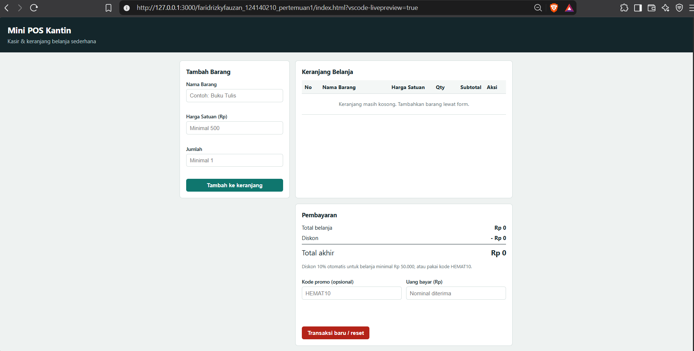
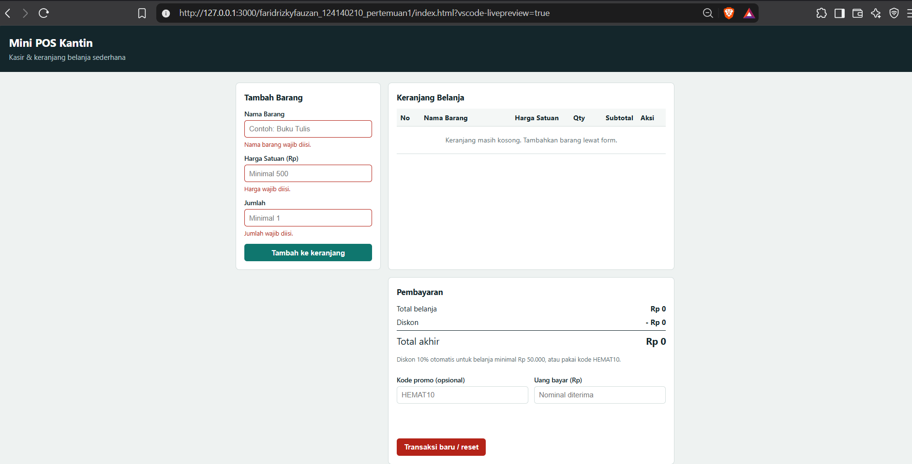
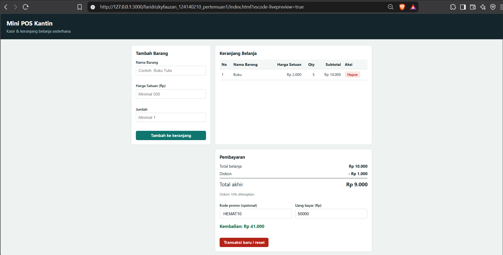
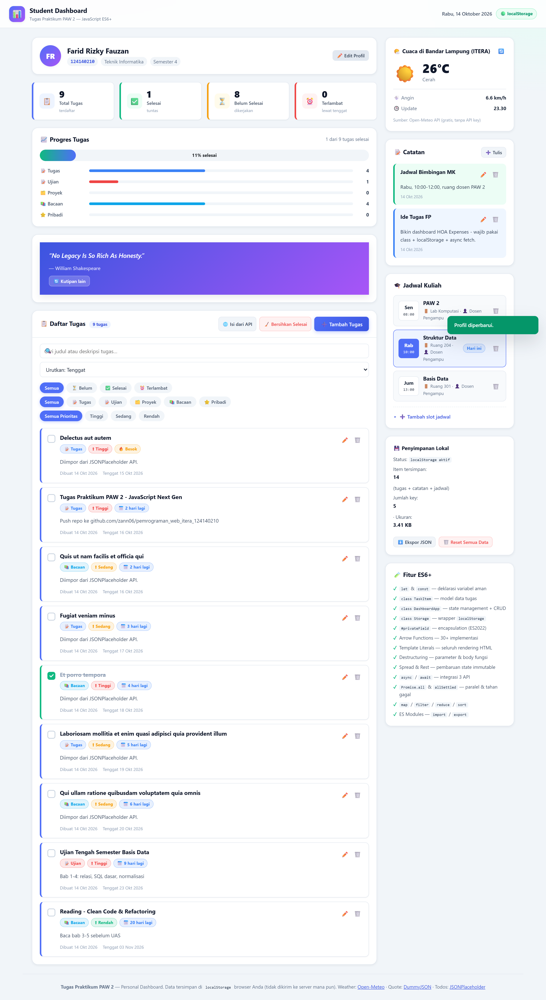
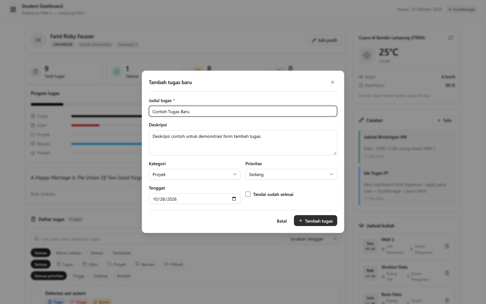
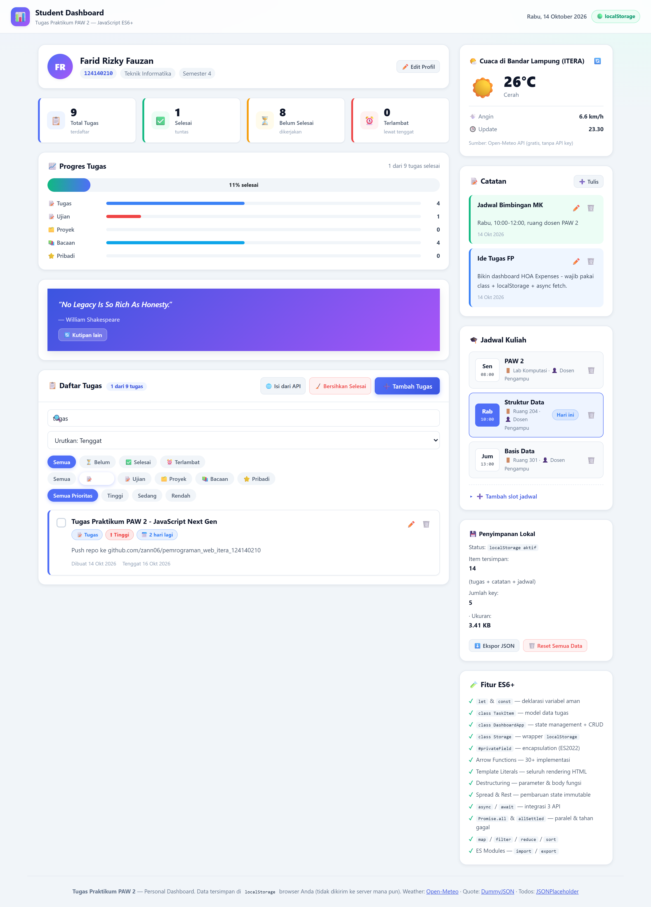
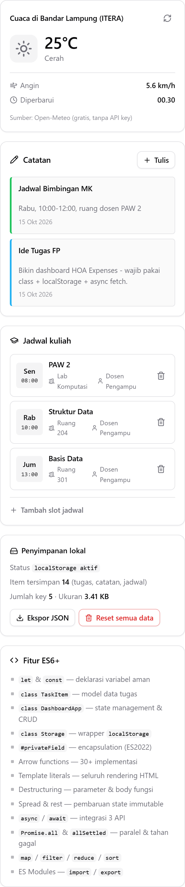
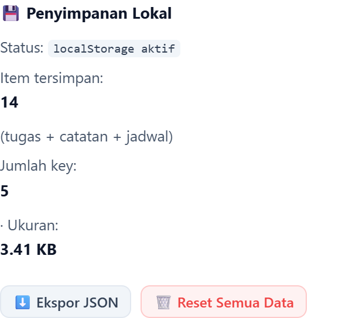
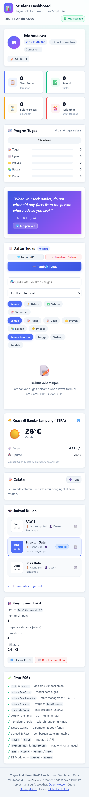

# pemrograman_web_itera_124140210

Repository praktikum Pemrograman Web ITERA.

## Identitas
- **Nama Lengkap**: Farid Rizky Fauzan
- **NIM**: 124140210
- **Kelas Praktikum**: RA

## Daftar Pertemuan
| Pertemuan | Folder | Isi |
|---|---|---|
| 1 | [faridrizkyfauzan_124140210_pertemuan1](faridrizkyfauzan_124140210_pertemuan1) | Tugas Mini POS + folder `modul/` (praktikum & latihan JavaScript Dasar) |
| 2 | [faridrizkyfauzan_124140210_pertemuan2](faridrizkyfauzan_124140210_pertemuan2) | Praktikum JS Next Gen (12 demo ES6+) + Tugas Personal Student Dashboard |

## 🔗 Coba Langsung

Aplikasi di repository ini **sudah dideploy** di GitHub Pages dan bisa
dibuka langsung tanpa install apa pun:

| Aplikasi | Tautan Langsung |
|---|---|
| **Tugas** — Personal Student Dashboard | <https://zann06.github.io/pemrograman_web_itera_124140210/faridrizkyfauzan_124140210_pertemuan2/02-tugas-personal-dashboard/index.html> |
| **Praktikum** — Demo Lab 12 Fitur ES6+ | <https://zann06.github.io/pemrograman_web_itera_124140210/faridrizkyfauzan_124140210_pertemuan2/01-praktikum-js-nextgen/index.html> |
| **Repository** | <https://github.com/zann06/pemrograman_web_itera_124140210> |

> **Catatan:**
> - Widget cuaca & kutipan membutuhkan koneksi internet.
> - Data tugas/catatan disimpan di `localStorage` browser masing-masing,
>   jadi data Anda tidak bercampur dengan pengunjung lain.

---

# Pertemuan 1 - Mini POS: Kasir & Keranjang Belanja Sederhana

## Deskripsi Aplikasi
Mini POS adalah aplikasi web kasir sederhana untuk kantin/toko kampus. Kasir memasukkan barang (nama, harga, qty), aplikasi menghitung subtotal, total, diskon, dan kembalian secara otomatis. Isi keranjang disimpan di `localStorage` sehingga tidak hilang saat halaman di-refresh. Aplikasi ini menyatukan tiga kompetensi praktikum: validasi form, kalkulator otomatis, dan manajemen keranjang berbasis localStorage.

Studi kasus yang dipilih adalah transaksi kasir di kantin/toko kampus. Tabel keranjang berfungsi sebagai riwayat data barang yang dibeli, dan kalkulator uang bayar/kembalian sebagai kalkulator keuangannya.

## Panduan Menjalankan
1. Clone repository ini, lalu buka foldernya di VS Code.
2. Install ekstensi **Live Server**.
3. Masuk ke folder `faridrizkyfauzan_124140210_pertemuan1`, klik kanan `index.html` → **Open with Live Server** (atau cukup double-click `index.html`, tanpa build/install apa pun).
4. Folder `modul/` berisi latihan praktikum; buka `index.html` di tiap subfolder dengan cara yang sama (butuh internet untuk Tailwind CDN dan Fetch API).

## Daftar Fitur
- [x] Validasi nama barang (wajib, min 3 karakter)
- [x] Validasi harga satuan (angka, min Rp 500)
- [x] Validasi qty (bilangan bulat, min 1)
- [x] Pesan error merah di bawah input; barang tidak masuk keranjang jika tidak valid
- [x] Form otomatis di-reset setelah berhasil
- [x] Subtotal per baris (harga × qty) dan total belanja otomatis
- [x] Diskon 10% untuk belanja ≥ Rp 50.000 atau kode promo `HEMAT10`
- [x] Kalkulator uang bayar dan kembalian, dengan pesan jika uang kurang
- [x] Tabel keranjang (No, Nama, Harga, Qty, Subtotal, Aksi) dengan tombol Hapus
- [x] Persistensi `localStorage` (`JSON.stringify` / `JSON.parse`)
- [x] Tombol Transaksi Baru / Reset
- [x] Format Rupiah dan tampilan responsif

## Tangkapan Layar
| Form input utama | Validasi error | Hasil perhitungan & tabel |
|---|---|---|
|  |  |  |

## Penjelasan Teknis Singkat
- **Validasi input**: `validasiForm()` memeriksa tiga field dan mengembalikan objek pesan error. `tampilkanError()` menulis pesan merah di bawah input. Jika ada error, fungsi `submit` berhenti (`return`) sehingga barang tidak ditambahkan.
- **Algoritma kalkulator**: `hitungTotal()` menjumlahkan `harga × qty` dengan `reduce()`. `hitungDiskon()` memberi 10% jika total ≥ 50.000 atau kode `HEMAT10` valid (tidak ditumpuk). Total akhir = total − diskon; kembalian = uang bayar − total akhir. Semua dihitung ulang oleh `renderSemua()` setiap keranjang atau input berubah.
- **Serialisasi localStorage**: setiap perubahan keranjang memanggil `simpanKeranjang()` (`JSON.stringify` ke key `mini_pos_keranjang`). Saat halaman dibuka, `muatKeranjang()` memakai `JSON.parse` dalam `try/catch` agar data rusak tidak membuat aplikasi error. Tombol reset memanggil `localStorage.removeItem`.

## Struktur Folder
```
pemrograman_web_itera_124140210/
├── README.md
└── faridrizkyfauzan_124140210_pertemuan1/
    ├── index.html
    ├── style.css
    ├── script.js
    ├── README.md
    ├── screenshots/
    └── modul/
        ├── 01_variabel_kondisional/   (praktikum.js + latihan.js)
        ├── 02_loop_fungsi/
        ├── 03_array_objek/
        └── 04_dom_api/
```

---

# Pertemuan 2 - JavaScript Next Gen (ES6+)

Topik pertemuan ini adalah **mengenal JavaScript Modern (ES6+)** — fondasi wajib sebelum masuk ke React.js di Pertemuan 3. Pengumpulan ini berisi dua bagian: materi praktikum (demo lab 12 fitur ES6+) dan tugas (aplikasi Personal Student Dashboard).

## Panduan Menjalankan

Kedua aplikasi **wajib** dijalankan lewat **Live Server**, **bukan double-click** — browser memblokir ES Module pada protokol `file://`.

```bash
# Clone repository ini, lalu:
cd faridrizkyfauzan_124140210_pertemuan2/01-praktikum-js-nextgen
python -m http.server 5500     # buka http://localhost:5500
```

Atau di VS Code: klik kanan `index.html` → **Open with Live Server**.

| Aplikasi | Alamat lokal | Yang dicek |
|---|---|---|
| Praktikum | `01-praktikum-js-nextgen/index.html` | Klik **▶ Run Demo** (10 demo sinkron), lalu **⏳ Jalankan Demo Async** (2 demo async, ±1 detik) |
| Tugas | `02-tugas-personal-dashboard/index.html` | Tunggu ±2 detik (3 API publik termuat), coba tambah/edit/hapus tugas, refresh → data tetap tersimpan |

## Struktur Folder

```
faridrizkyfauzan_124140210_pertemuan2/
├── 01-praktikum-js-nextgen/          # Praktikum — demo lab 12 fitur ES6+
│   ├── index.html
│   ├── README.md                     # Dokumentasi lengkap
│   ├── LICENSE
│   ├── .gitignore
│   ├── css/style.css
│   └── js/
│       ├── main.js                   # Entry point / DOM controller
│       ├── app.js                    # 12 fungsi demo ES6+
│       └── modules/
│           ├── data.js               # sampleUsers, sampleProducts, apiConfig
│           └── utils.js              # formatRupiah, capitalize, dll
│
└── 02-tugas-personal-dashboard/      # Tugas — Personal Student Dashboard
    ├── index.html
    ├── README.md                     # Dokumentasi lengkap
    ├── LICENSE
    ├── .gitignore
    ├── css/style.css
    ├── docs/                         # Screenshot untuk laporan
    └── js/
        ├── main.js                   # Controller (event, modal, async)
        ├── app.js                    # Renderer (seluruh template literal HTML)
        └── modules/
            ├── classes.js            # class TaskItem & class DashboardApp
            ├── storage.js            # class Storage (wrapper localStorage)
            ├── api.js                # Async/Await + integrasi 3 API publik
            ├── constants.js          # Konfigurasi terpusat
            └── utils.js              # 15+ arrow function helper
```

## Bagian 1 — Praktikum: Demo Lab 12 Fitur ES6+

Demo lab interaktif yang membandingkan **cara lama vs cara modern** untuk setiap topik.

| # | Topik | Fitur Utama |
|---|---|---|
| 1 | Let dan Const | block scope, TDZ, `const` untuk objek |
| 2 | Arrow Functions | implicit return, lexical `this` |
| 3 | Template Literals | `${}`, string multi-baris tanpa escape |
| 4 | Destructuring | object/array, nested 3 level, skip elemen, swap |
| 5 | Spread & Rest | operator `...`, shallow copy |
| 6 | Default Parameters | bug operator `||` vs default parameter |
| 7 | Classes | `extends`, `super`, getter/setter, `static`, private field `#` |
| 8 | Enhanced Object Literals | property & method shorthand, computed property |
| 9 | Modern Array Methods | `map`/`filter`/`find`/`some`/`every`/`reduce` + chaining |
| 10 | Advanced Arrays | `Array.from`, `flat`, `flatMap`, `at`, `findLast`, `structuredClone` |
| 11 | Promises | `then`/`catch`/`finally`, `Promise.all`/`race`/`allSettled` |
| 12 | Async / Await | `try/catch`, eksekusi paralel, integrasi API nyata |

📖 Dokumentasi rinci: [`01-praktikum-js-nextgen/README.md`](faridrizkyfauzan_124140210_pertemuan2/01-praktikum-js-nextgen/README.md)

## Bagian 2 — Tugas: Personal Student Dashboard

Aplikasi dashboard mahasiswa — bukan to-do list generik, tapi memakai konteks perkuliahan nyata.

### Fitur
- **CRUD tugas lengkap** — tambah, edit, hapus, tandai selesai, bersihkan yang selesai
- **Filter & pencarian** — cari live, filter kategori / prioritas / status, 4 opsi sortir
- **Catatan pribadi** — 5 warna klasifikasi
- **Jadwal kuliah** — tambah/hapus slot, urut otomatis, badge "Hari ini"
- **Statistik** — 4 kartu ringkasan, progress bar, distribusi per kategori
- **Cuaca real-time** (Open-Meteo) — koordinat ITERA, Lampung Selatan
- **Kutipan motivasi** (DummyJSON) — tombol "Kutipan lain"
- **Seeding tugas** dari JSONPlaceholder pada kunjungan pertama
- **Penyimpanan lokal** — `localStorage` + ekspor JSON + reset
- **UX** — toast, loading spinner, modal (tutup via tombol/backdrop/`Esc`), responsif, aksesibel

### Arsitektur Kode
Mengikuti objek berorientasi objek modern sesuai arahan tugas:

| Class | File | Tanggung Jawab |
|---|---|---|
| `TaskItem` | `js/modules/classes.js` | Model satu item tugas — validasi di constructor, getter turunan (`isOverdue`, `isUrgent`), `toJSON()`/`fromJSON()` |
| `DashboardApp` | `js/modules/classes.js` | State management — CRUD, filter/sort, agregasi statistik, persistensi |
| `Storage` | `js/modules/storage.js` | Wrapper `localStorage` — `try/catch` quota, fallback in-memory, namespacing |

Prinsip yang diterapkan: **encapsulation** (`#tasks` private field), **immutability** (`[...arr, x]`, bukan `push`), **observer pattern** (`subscribe()`), dan **separation of concerns** (model / storage / API / view / controller terpisah).

### Fitur ES6+ yang Digunakan
- Arrow function (puluhan) — termasuk *higher-order function* dan *currying*
- Template literals untuk seluruh rendering HTML
- Destructuring di parameter fungsi dan di dalam body
- Spread `...` dan rest parameter, update state secara immutable
- `class`, `extends`, `super()`, getter/setter, `static`, private field `#` (ES2022)
- `async` / `await`, `try/catch`, `Promise.all`, `Promise.allSettled`, `AbortController`, dynamic `import()`
- Array methods: `map`, `filter`, `find`, `reduce`, `some`, `every`, `flat`, `flatMap`, `includes`, `at`, `findLast`
- ES Modules (`import` / `export`) di seluruh kode

📖 Dokumentasi rinci: [`02-tugas-personal-dashboard/README.md`](faridrizkyfauzan_124140210_pertemuan2/02-tugas-personal-dashboard/README.md)

### Tangkapan Layar — Pertemuan 2

| Dashboard utama | Form tambah tugas | Filter & pencarian |
|---|---|---|
|  |  |  |

| Widget async (cuaca, kutipan, jadwal) | Panel penyimpanan lokal | Tampilan mobile |
|---|---|---|
|  |  |  |

| Demo lab ES6+ — demo sinkron | Demo async — Promise & Async/Await |
|---|---|
|  |  |

