# pemrograman_web_itera_124140210

Repository praktikum Pemrograman Web ITERA.

## Identitas
- **Nama Lengkap**: Farid Rizky Fauzan
- **NIM**: 124140210
- **Kelas Praktikum**: RA

## Daftar Pertemuan
| Pertemuan | Folder | Isi |
|---|---|---|
| 1 | [faridrizkyfauzan_124140210_pertemuan1](faridrizkyfauzan_124140210_pertemuan1) | Tugas Mini POS + folder `modul/` (praktikum & latihan JavaScript Dasar) |
| 2 | [faridrizkyfauzan_124140210_pertemuan2](faridrizkyfauzan_124140210_pertemuan2) | Praktikum JS Next Gen (12 demo ES6+) + Tugas Personal Student Dashboard |
| 3 | [faridrizkyfauzan_124140210_pertemuan3](faridrizkyfauzan_124140210_pertemuan3) | Praktikum React Basics (7 topik interaktif) + Tugas Aplikasi Manajemen Buku |
| 4 | [faridrizkyfauzan_124140210_pertemuan4](faridrizkyfauzan_124140210_pertemuan4) | Praktikum Python Dasar (6 topik + 6 latihan) + Tugas BMI, Nilai Mahasiswa & Modul Matematika |
| 4 | [faridrizkyfauzan_124140210_pertemuan4](faridrizkyfauzan_124140210_pertemuan4) | Tugas Python Dasar: Penghitung BMI, Pengelolaan Nilai Mahasiswa, Modul Matematika |

## 🔗 Coba Langsung

Aplikasi di repository ini **sudah dideploy** di GitHub Pages dan bisa
dibuka langsung tanpa install apa pun:

| Aplikasi | Pertemuan | Tautan Langsung |
|---|---|---|
| **Tugas** — Aplikasi Manajemen Buku | 3 | <https://zann06.github.io/pemrograman_web_itera_124140210/faridrizkyfauzan_124140210_pertemuan3/02-tugas-manajemen-buku/dist/index.html> |
| **Praktikum** — 7 Topik React | 3 | <https://zann06.github.io/pemrograman_web_itera_124140210/faridrizkyfauzan_124140210_pertemuan3/01-praktikum-react-basics/dist/index.html> |
| **Tugas** — Personal Student Dashboard | 2 | <https://zann06.github.io/pemrograman_web_itera_124140210/faridrizkyfauzan_124140210_pertemuan2/02-tugas-personal-dashboard/index.html> |
| **Praktikum** — Demo Lab 12 Fitur ES6+ | 2 | <https://zann06.github.io/pemrograman_web_itera_124140210/faridrizkyfauzan_124140210_pertemuan2/01-praktikum-js-nextgen/index.html> |
| **Repository** | - | <https://github.com/zann06/pemrograman_web_itera_124140210> |

> **Catatan:**
> - Widget cuaca & kutipan (Pertemuan 2) membutuhkan koneksi internet.
> - Data tugas/catatan/buku disimpan di `localStorage` browser masing-masing,
>   jadi data Anda tidak bercampur dengan pengunjung lain.
> - Dua aplikasi Pertemuan 3 memakai **Vite**, jadi yang disajikan GitHub Pages
>   adalah hasil `npm run build` yang ikut di-commit di folder `dist/`.

---

# Pertemuan 1 - Mini POS: Kasir & Keranjang Belanja Sederhana

## Deskripsi Aplikasi
Mini POS adalah aplikasi web kasir sederhana untuk kantin/toko kampus. Kasir memasukkan barang (nama, harga, qty), aplikasi menghitung subtotal, total, diskon, dan kembalian secara otomatis. Isi keranjang disimpan di `localStorage` sehingga tidak hilang saat halaman di-refresh. Aplikasi ini menyatukan tiga kompetensi praktikum: validasi form, kalkulator otomatis, dan manajemen keranjang berbasis localStorage.

Studi kasus yang dipilih adalah transaksi kasir di kantin/toko kampus. Tabel keranjang berfungsi sebagai riwayat data barang yang dibeli, dan kalkulator uang bayar/kembalian sebagai kalkulator keuangannya.

## Panduan Menjalankan
1. Clone repository ini, lalu buka foldernya di VS Code.
2. Install ekstensi **Live Server**.
3. Masuk ke folder `faridrizkyfauzan_124140210_pertemuan1`, klik kanan `index.html` → **Open with Live Server** (atau cukup double-click `index.html`, tanpa build/install apa pun).
4. Folder `modul/` berisi latihan praktikum; buka `index.html` di tiap subfolder dengan cara yang sama (butuh internet untuk Tailwind CDN dan Fetch API).

## Daftar Fitur
- [x] Validasi nama barang (wajib, min 3 karakter)
- [x] Validasi harga satuan (angka, min Rp 500)
- [x] Validasi qty (bilangan bulat, min 1)
- [x] Pesan error merah di bawah input; barang tidak masuk keranjang jika tidak valid
- [x] Form otomatis di-reset setelah berhasil
- [x] Subtotal per baris (harga × qty) dan total belanja otomatis
- [x] Diskon 10% untuk belanja ≥ Rp 50.000 atau kode promo `HEMAT10`
- [x] Kalkulator uang bayar dan kembalian, dengan pesan jika uang kurang
- [x] Tabel keranjang (No, Nama, Harga, Qty, Subtotal, Aksi) dengan tombol Hapus
- [x] Persistensi `localStorage` (`JSON.stringify` / `JSON.parse`)
- [x] Tombol Transaksi Baru / Reset
- [x] Format Rupiah dan tampilan responsif

## Tangkapan Layar
| Form input utama | Validasi error | Hasil perhitungan & tabel |
|---|---|---|
| 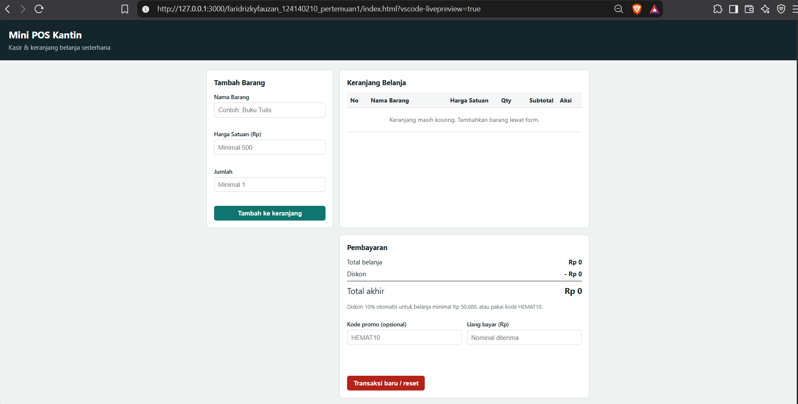 | 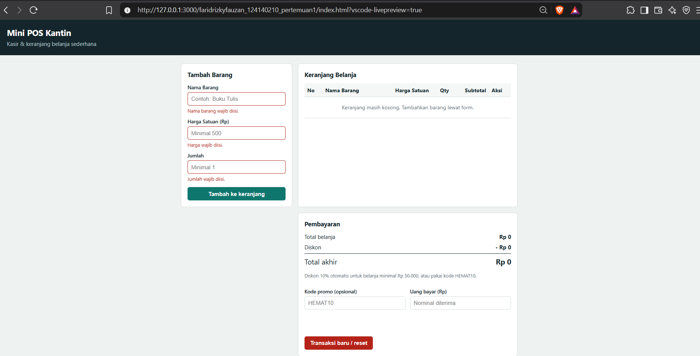 | 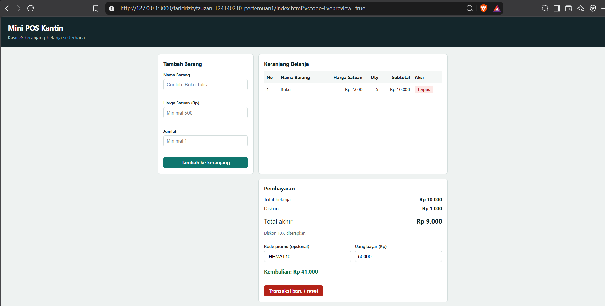 |

## Penjelasan Teknis Singkat
- **Validasi input**: `validasiForm()` memeriksa tiga field dan mengembalikan objek pesan error. `tampilkanError()` menulis pesan merah di bawah input. Jika ada error, fungsi `submit` berhenti (`return`) sehingga barang tidak ditambahkan.
- **Algoritma kalkulator**: `hitungTotal()` menjumlahkan `harga × qty` dengan `reduce()`. `hitungDiskon()` memberi 10% jika total ≥ 50.000 atau kode `HEMAT10` valid (tidak ditumpuk). Total akhir = total − diskon; kembalian = uang bayar − total akhir. Semua dihitung ulang oleh `renderSemua()` setiap keranjang atau input berubah.
- **Serialisasi localStorage**: setiap perubahan keranjang memanggil `simpanKeranjang()` (`JSON.stringify` ke key `mini_pos_keranjang`). Saat halaman dibuka, `muatKeranjang()` memakai `JSON.parse` dalam `try/catch` agar data rusak tidak membuat aplikasi error. Tombol reset memanggil `localStorage.removeItem`.

## Struktur Folder
```
pemrograman_web_itera_124140210/
├── README.md
└── faridrizkyfauzan_124140210_pertemuan1/
    ├── index.html
    ├── style.css
    ├── script.js
    ├── README.md
    ├── screenshots/
    └── modul/
        ├── 01_variabel_kondisional/   (praktikum.js + latihan.js)
        ├── 02_loop_fungsi/
        ├── 03_array_objek/
        └── 04_dom_api/
```

---

# Pertemuan 2 - JavaScript Next Gen (ES6+)

Topik pertemuan ini adalah **mengenal JavaScript Modern (ES6+)** — fondasi wajib sebelum masuk ke React.js di Pertemuan 3. Pengumpulan ini berisi dua bagian: materi praktikum (demo lab 12 fitur ES6+) dan tugas (aplikasi Personal Student Dashboard).

## Panduan Menjalankan

Kedua aplikasi **wajib** dijalankan lewat **Live Server**, **bukan double-click** — browser memblokir ES Module pada protokol `file://`.

```bash
# Clone repository ini, lalu:
cd faridrizkyfauzan_124140210_pertemuan2/01-praktikum-js-nextgen
python -m http.server 5500     # buka http://localhost:5500
```

Atau di VS Code: klik kanan `index.html` → **Open with Live Server**.

| Aplikasi | Alamat lokal | Yang dicek |
|---|---|---|
| Praktikum | `01-praktikum-js-nextgen/index.html` | Klik **▶ Run Demo** (10 demo sinkron), lalu **⏳ Jalankan Demo Async** (2 demo async, ±1 detik) |
| Tugas | `02-tugas-personal-dashboard/index.html` | Tunggu ±2 detik (3 API publik termuat), coba tambah/edit/hapus tugas, refresh → data tetap tersimpan |

## Struktur Folder

```
faridrizkyfauzan_124140210_pertemuan2/
├── 01-praktikum-js-nextgen/          # Praktikum — demo lab 12 fitur ES6+
│   ├── index.html
│   ├── README.md                     # Dokumentasi lengkap
│   ├── LICENSE
│   ├── .gitignore
│   ├── css/style.css
│   └── js/
│       ├── main.js                   # Entry point / DOM controller
│       ├── app.js                    # 12 fungsi demo ES6+
│       └── modules/
│           ├── data.js               # sampleUsers, sampleProducts, apiConfig
│           └── utils.js              # formatRupiah, capitalize, dll
│
└── 02-tugas-personal-dashboard/      # Tugas — Personal Student Dashboard
    ├── index.html
    ├── README.md                     # Dokumentasi lengkap
    ├── LICENSE
    ├── .gitignore
    ├── css/style.css
    ├── docs/                         # Screenshot untuk laporan
    └── js/
        ├── main.js                   # Controller (event, modal, async)
        ├── app.js                    # Renderer (seluruh template literal HTML)
        └── modules/
            ├── classes.js            # class TaskItem & class DashboardApp
            ├── storage.js            # class Storage (wrapper localStorage)
            ├── api.js                # Async/Await + integrasi 3 API publik
            ├── constants.js          # Konfigurasi terpusat
            └── utils.js              # 15+ arrow function helper
```

## Bagian 1 — Praktikum: Demo Lab 12 Fitur ES6+

Demo lab interaktif yang membandingkan **cara lama vs cara modern** untuk setiap topik.

| # | Topik | Fitur Utama |
|---|---|---|
| 1 | Let dan Const | block scope, TDZ, `const` untuk objek |
| 2 | Arrow Functions | implicit return, lexical `this` |
| 3 | Template Literals | `${}`, string multi-baris tanpa escape |
| 4 | Destructuring | object/array, nested 3 level, skip elemen, swap |
| 5 | Spread & Rest | operator `...`, shallow copy |
| 6 | Default Parameters | bug operator `||` vs default parameter |
| 7 | Classes | `extends`, `super`, getter/setter, `static`, private field `#` |
| 8 | Enhanced Object Literals | property & method shorthand, computed property |
| 9 | Modern Array Methods | `map`/`filter`/`find`/`some`/`every`/`reduce` + chaining |
| 10 | Advanced Arrays | `Array.from`, `flat`, `flatMap`, `at`, `findLast`, `structuredClone` |
| 11 | Promises | `then`/`catch`/`finally`, `Promise.all`/`race`/`allSettled` |
| 12 | Async / Await | `try/catch`, eksekusi paralel, integrasi API nyata |

📖 Dokumentasi rinci: [`01-praktikum-js-nextgen/README.md`](faridrizkyfauzan_124140210_pertemuan2/01-praktikum-js-nextgen/README.md)

## Bagian 2 — Tugas: Personal Student Dashboard

Aplikasi dashboard mahasiswa — bukan to-do list generik, tapi memakai konteks perkuliahan nyata.

### Fitur
- **CRUD tugas lengkap** — tambah, edit, hapus, tandai selesai, bersihkan yang selesai
- **Filter & pencarian** — cari live, filter kategori / prioritas / status, 4 opsi sortir
- **Catatan pribadi** — 5 warna klasifikasi
- **Jadwal kuliah** — tambah/hapus slot, urut otomatis, badge "Hari ini"
- **Statistik** — 4 kartu ringkasan, progress bar, distribusi per kategori
- **Cuaca real-time** (Open-Meteo) — koordinat ITERA, Lampung Selatan
- **Kutipan motivasi** (DummyJSON) — tombol "Kutipan lain"
- **Seeding tugas** dari JSONPlaceholder pada kunjungan pertama
- **Penyimpanan lokal** — `localStorage` + ekspor JSON + reset
- **UX** — toast, loading spinner, modal (tutup via tombol/backdrop/`Esc`), responsif, aksesibel

### Arsitektur Kode
Mengikuti objek berorientasi objek modern sesuai arahan tugas:

| Class | File | Tanggung Jawab |
|---|---|---|
| `TaskItem` | `js/modules/classes.js` | Model satu item tugas — validasi di constructor, getter turunan (`isOverdue`, `isUrgent`), `toJSON()`/`fromJSON()` |
| `DashboardApp` | `js/modules/classes.js` | State management — CRUD, filter/sort, agregasi statistik, persistensi |
| `Storage` | `js/modules/storage.js` | Wrapper `localStorage` — `try/catch` quota, fallback in-memory, namespacing |

Prinsip yang diterapkan: **encapsulation** (`#tasks` private field), **immutability** (`[...arr, x]`, bukan `push`), **observer pattern** (`subscribe()`), dan **separation of concerns** (model / storage / API / view / controller terpisah).

### Fitur ES6+ yang Digunakan
- Arrow function (puluhan) — termasuk *higher-order function* dan *currying*
- Template literals untuk seluruh rendering HTML
- Destructuring di parameter fungsi dan di dalam body
- Spread `...` dan rest parameter, update state secara immutable
- `class`, `extends`, `super()`, getter/setter, `static`, private field `#` (ES2022)
- `async` / `await`, `try/catch`, `Promise.all`, `Promise.allSettled`, `AbortController`, dynamic `import()`
- Array methods: `map`, `filter`, `find`, `reduce`, `some`, `every`, `flat`, `flatMap`, `includes`, `at`, `findLast`
- ES Modules (`import` / `export`) di seluruh kode

📖 Dokumentasi rinci: [`02-tugas-personal-dashboard/README.md`](faridrizkyfauzan_124140210_pertemuan2/02-tugas-personal-dashboard/README.md)

### Tangkapan Layar — Pertemuan 2

| Dashboard utama | Form tambah tugas | Filter & pencarian |
|---|---|---|
| 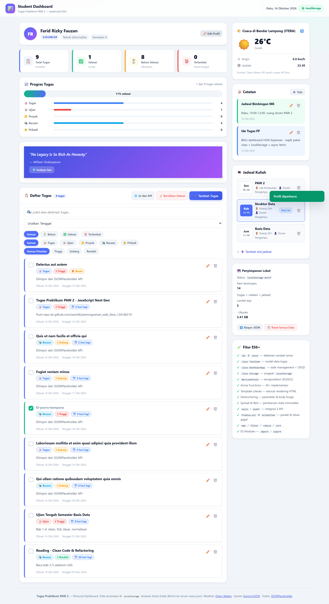 | 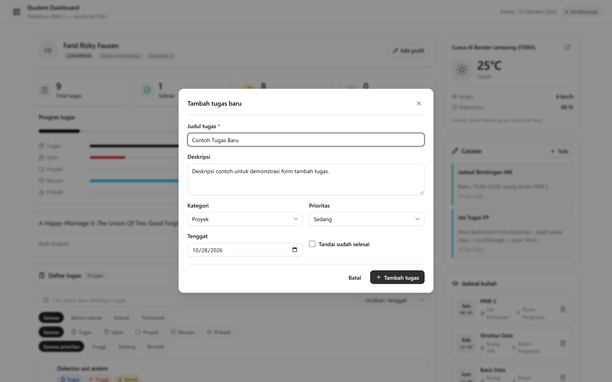 | 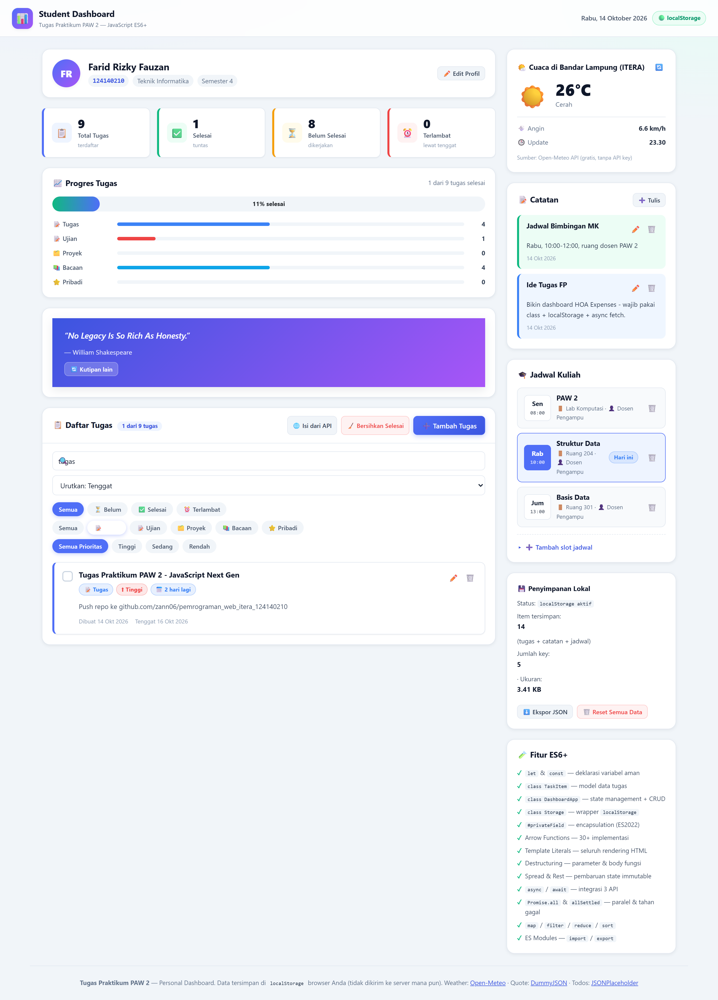 |

| Widget async (cuaca, kutipan, jadwal) | Panel penyimpanan lokal | Tampilan mobile |
|---|---|---|
| 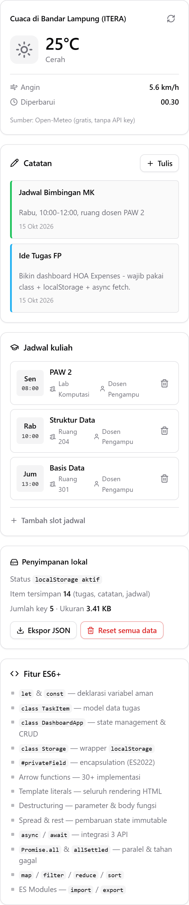 | 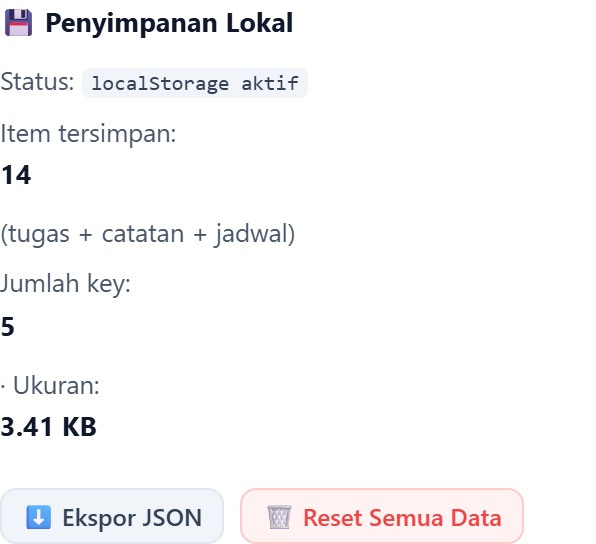 | 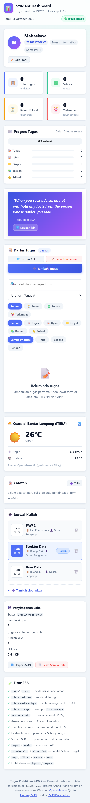 |

| Demo lab ES6+ — demo sinkron | Demo async — Promise & Async/Await |
|---|---|
| 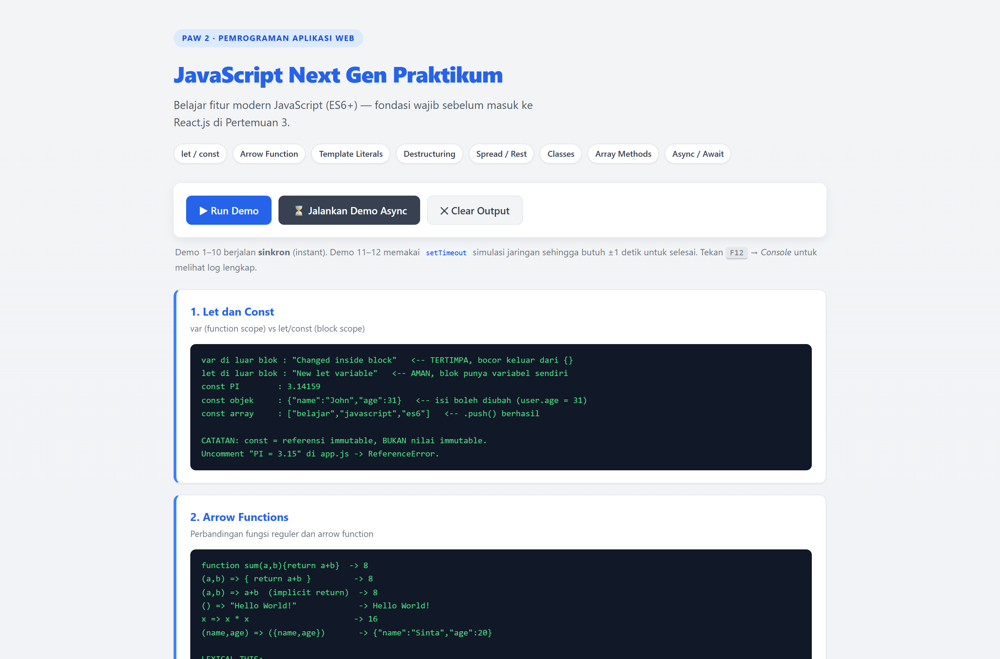 | 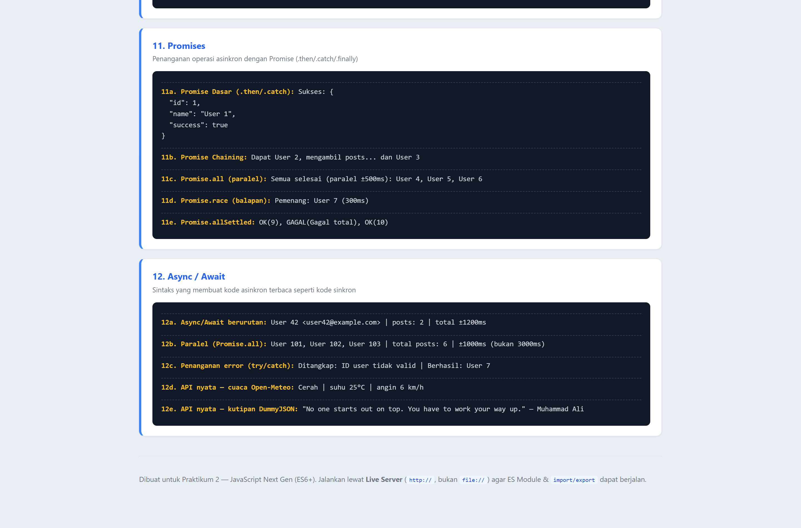 |

---

# Pertemuan 3 - React Basics

Topik pertemuan ini adalah **React** - perpindahan dari JavaScript murni ke
arsitektur berbasis komponen. Pengumpulan ini berisi dua bagian, mengikuti
pola Pertemuan 1 dan 2.

```bash
# Bagian 1 - Praktikum (http://localhost:5173)
cd faridrizkyfauzan_124140210_pertemuan3/01-praktikum-react-basics
npm install && npm run dev

# Bagian 2 - Tugas (http://localhost:5174)
cd ../02-tugas-manajemen-buku
npm install && npm run dev
```

> Keduanya memakai **Vite + React 19**, jadi harus dijalankan lewat `npm run dev`.
> Membuka `index.html` langsung dengan double-click tidak akan bekerja.

## Struktur Folder

```
faridrizkyfauzan_124140210_pertemuan3/
├── 01-praktikum-react-basics/        # 7 topik, tiap topik 1 file
│   └── src/topics/Topic1.jsx ... Topic7.jsx
└── 02-tugas-manajemen-buku/           # Aplikasi Manajemen Buku
    └── src/
        ├── context/BookContext.jsx    # Global state (Context API)
        ├── hooks/                     # 4 custom hook
        ├── components/                # 8 komponen reusable
        ├── pages/                     # Home, Stats, About
        └── __tests__/                 # 73 unit test
```

## Bagian 1 — Praktikum: 7 Topik React

| # | Topik | Yang Didemonstrasikan |
|---|---|---|
| 1 | Setup Project React | Perintah Vite, struktur folder, sintaks JSX |
| 2 | Components & Props | Props, `children`, komposisi, `key` pada list |
| 3 | State & Hooks | `useState`, derived state, `useEffect` + cleanup |
| 4 | React Router | Nested route + `Outlet`, `useParams`, `useNavigate` |
| 5 | Custom Hook | `useCounter`, `useDebounce`, `useToggle` |
| 6 | Context API | Props drilling vs provider-consumer |
| 7 | Testing | Vitest + RTL, query berbasis aksesibilitas |

Setiap halaman punya penjelasan singkat, potongan kode, dan demo yang bisa
diklik langsung.

📖 Dokumentasi rinci: [`01-praktikum-react-basics/README.md`](faridrizkyfauzan_124140210_pertemuan3/01-praktikum-react-basics/README.md)

## Bagian 2 — Tugas: Aplikasi Manajemen Buku

Aplikasi manajemen buku pribadi — catatan buku yang **dimiliki**, **sedang
dibaca**, dan **ingin dibeli**, dipisahkan agar keputusan baca berikutnya lebih
mudah diambil.

### Fitur
- **CRUD lengkap** — tambah, edit, hapus (dengan dialog konfirmasi), tandai favorit
- **Filter & pencarian** — 3 status, cari judul/penulis realtime, 5 opsi sorting
- **Halaman statistik** — total, penulis unik, rata-rata tahun, progress bar distribusi
- **Penyimpanan lokal** — `localStorage` dengan penanganan JSON rusak & kuota penuh
- **Validasi form** — pesan error per field, hanya muncul setelah field disentuh
- **UX** — toast, empty state terpisah untuk "kosong" vs "tidak cocok", tema gelap, responsif

### Konsep React yang diterapkan

| Konsep | Implementasi |
|---|---|
| Context API | `BookProvider` menyimpan seluruh koleksi; 8 komponen membacanya tanpa props drilling |
| Custom hook | `useLocalStorage`, `useBookStats`, `useBookFilter`, `useToast` |
| React Router | `HashRouter` dengan 3 halaman + route 404 |
| Controlled components | Seluruh input controlled; reset form satu baris |
| Optimasi render | `useMemo` pada context value, `useCallback` pada action, `key` berbasis `book.id` |
| PropTypes | Setiap komponen punya kontrak props lengkap |

### Dua keputusan yang perlu dijelaskan

1. **`HashRouter`, bukan `BrowserRouter`** — API-nya identik, tetapi URL-nya
   berawalan `/#/` sehingga aplikasi bisa dibuka dari hosting statis (GitHub
   Pages) tanpa rewrite di server. Repository ini memang dideploy ke sana.
2. **`defaultProps` tidak dipakai** — sudah dihapus mulai React 19. Semua nilai
   default ditulis sebagai default parameter di tanda tangan fungsi.

📖 Dokumentasi rinci: [`02-tugas-manajemen-buku/README.md`](faridrizkyfauzan_124140210_pertemuan3/02-tugas-manajemen-buku/README.md)

### Tangkapan Layar — Pertemuan 3

| Koleksi utama | Validasi error | Halaman statistik |
|---|---|---|
| 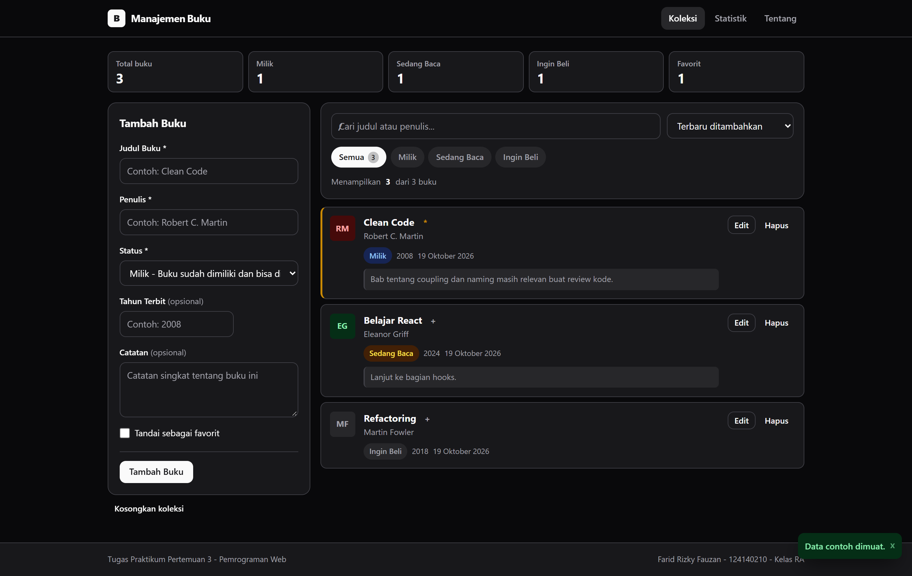 | 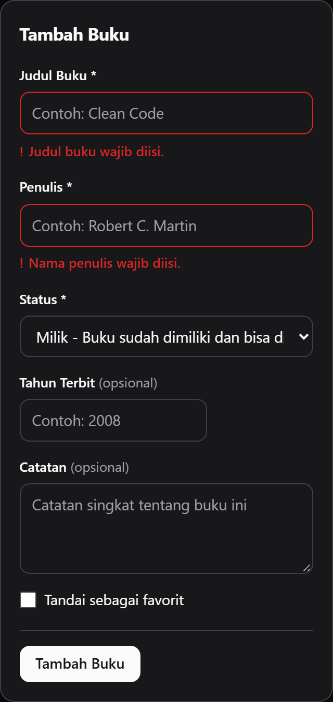 | 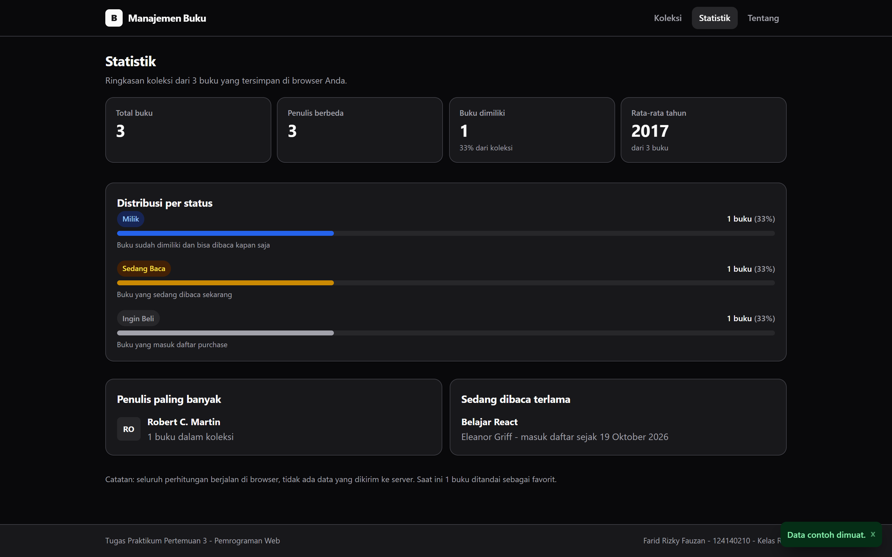 |

| Filter dan pencarian | Dialog konfirmasi hapus | Tampilan mobile |
|---|---|---|
| 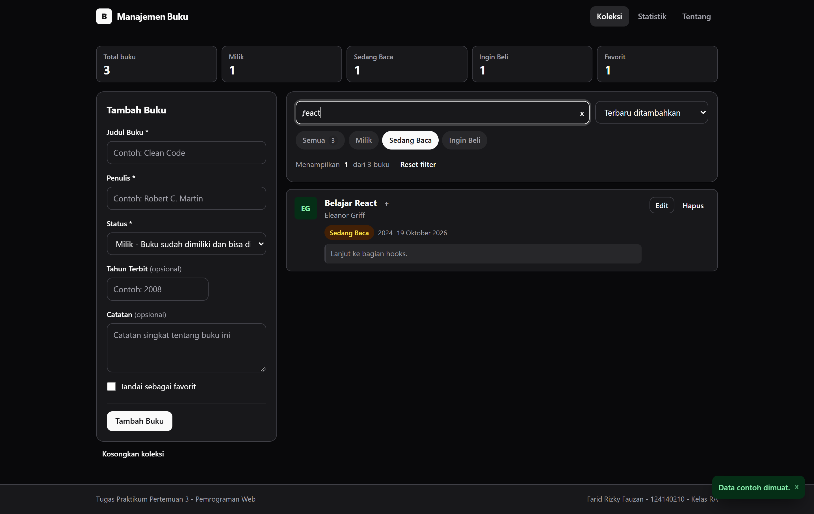 | 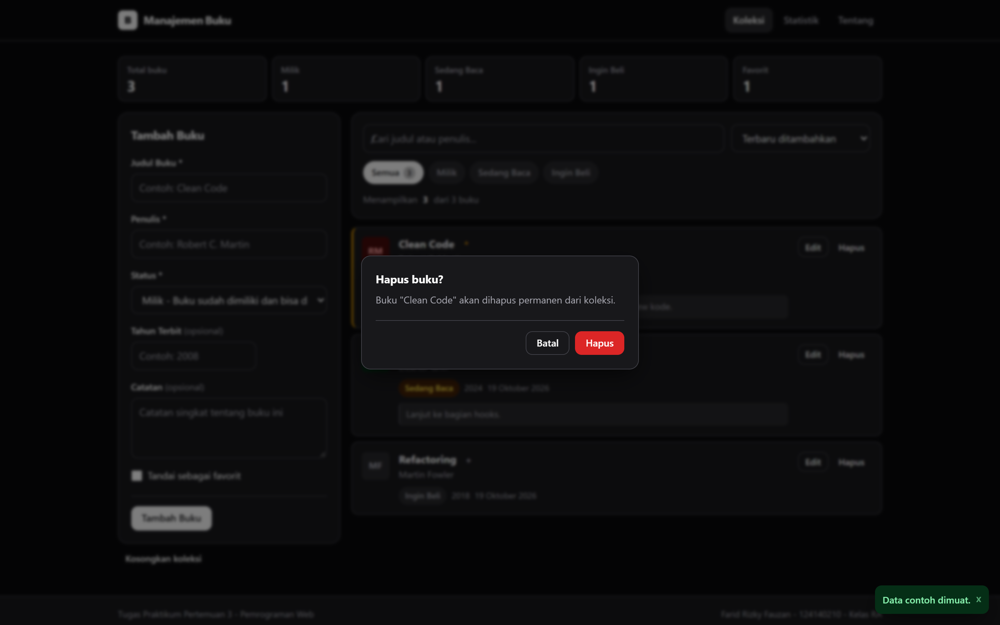 | 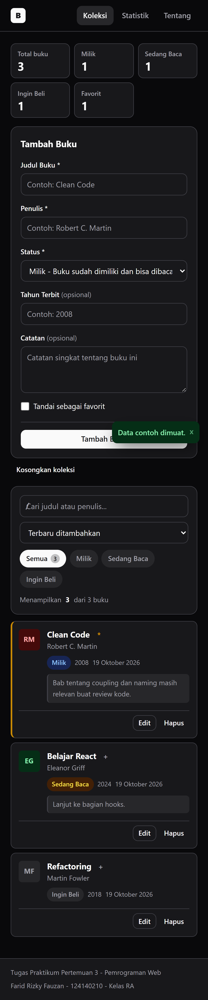 |

Laporan eksekusi unit test (`npm test`):

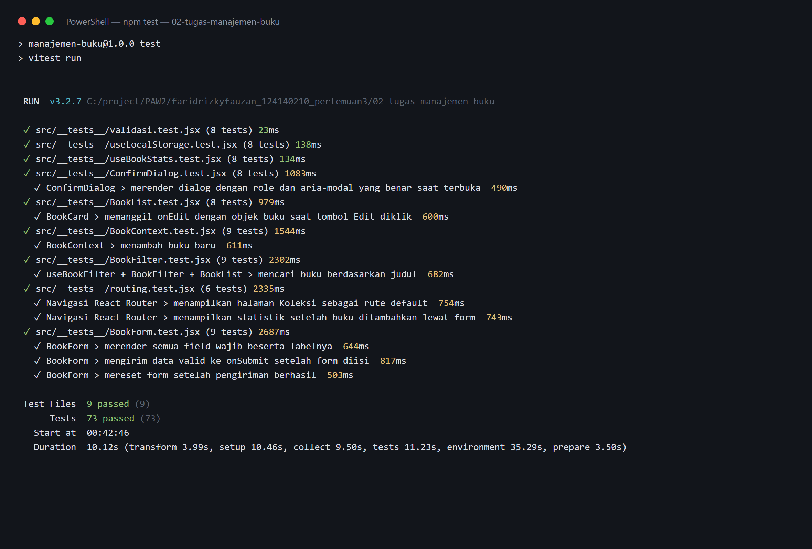

---

# Pertemuan 4 - Python Dasar

Topik pertemuan ini adalah **Python Dasar** — perpindahan dari frontend
(JavaScript/React) ke fondasi backend. Pengumpulan berisi dua bagian:
materi praktikum (6 berkas topik + 6 latihan mandiri) dan tugas (3 program
Python). Berbeda dengan pertemuan sebelumnya, hasilnya berupa program
terminal yang dijalankan dengan interpreter Python, bukan aplikasi web.

```bash
# Tugas - dijalankan dari dalam folder pertemuan 4
cd faridrizkyfauzan_124140210_pertemuan4
python tugas1_bmi.py               # input berat (kg) & tinggi (m)
python tugas2_nilai_mahasiswa.py   # tabel nilai + grade + tertinggi/terendah
python main.py                     # uji seluruh fungsi modul math_operations
```

## Struktur Folder

```
faridrizkyfauzan_124140210_pertemuan4/
├── tugas1_bmi.py                  # Tugas 1 (30%) - Penghitung BMI
├── tugas2_nilai_mahasiswa.py      # Tugas 2 (40%) - Pengelolaan Nilai Mahasiswa
├── math_operations.py             # Tugas 3 (30%) - Modul matematika (geometri + suhu)
├── main.py                        # Tugas 3 (30%) - Program utama, 2 cara impor
├── screenshots/                   # Bukti eksekusi terminal
└── praktikum/                     # 6 berkas topik + latihan/ (6 latihan mandiri)
```

## Bagian 1 — Tugas

| # | Program | Poin Utama | Bobot |
|---|---|---|---|
| 1 | `tugas1_bmi.py` | Input tervalidasi, rumus BMI, kategori if-elif-else (4 kategori), f-string 2 desimal | 30% |
| 2 | `tugas2_nilai_mahasiswa.py` | List 6 dictionary, bobot 30/40/30, grade A–E, tabel perataan f-string, tertinggi & terendah | 40% |
| 3 | `math_operations.py` + `main.py` | 6 fungsi geometri, 2 konversi suhu, konstanta PI, `if __name__ == "__main__"`, 2 cara impor berbeda | 30% |

## Bagian 2 — Praktikum

| # | Berkas | Materi |
|---|---|---|
| 1 | `01_pengenalan.py` | `print()`, `sep`, `end`, escape character |
| 2 | `02_variabel.py` | tipe data, `type()`, f-string, slicing, casting, `input()` |
| 3 | `03_kendali.py` | if/elif/else, ternary, `range()`, `enumerate()`, while + break/continue/else |
| 4 | `04_fungsi.py` | default arg, multiple return, `*args`/`**kwargs`, lambda + `sorted()` |
| 5 | `05_struktur_data.py` | list ops, comprehension, tuple, dict + `.get()`, set operations |
| 6 | `06_modul_app.py` | standard library (math, random, datetime) + modul kustom |

Latihan mandiri (identitas, suhu, tebak angka, validator password, kontak,
generator password) ada di `praktikum/latihan/`.

📖 Dokumentasi rinci: [`faridrizkyfauzan_124140210_pertemuan4/README.md`](faridrizkyfauzan_124140210_pertemuan4/README.md)

### Tangkapan Layar — Pertemuan 4

| Tugas 1 — BMI | Tugas 2 — Tabel nilai | Tugas 3 — Modul |
|---|---|---|
| 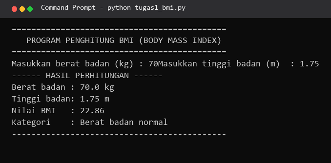 | 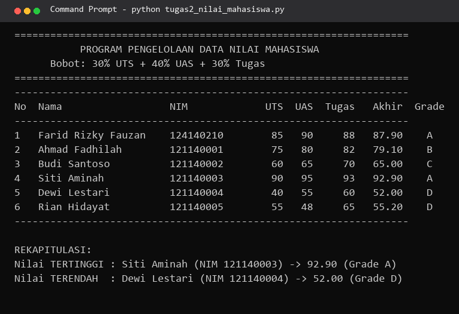 | 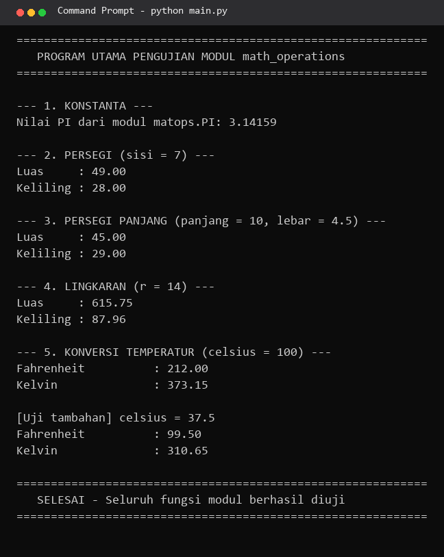 |

---

# Pertemuan 4 - Python Dasar

Topik pertemuan ini adalah **Python Dasar** — fondasi bahasa Python sebelum
masuk ke Python OOP (Pertemuan 5) dan framework Pyramid. Pengumpulan ini
berisi materi praktikum (6 topik + 6 latihan mandiri) dan tiga tugas
praktikum: penghitung BMI, pengelolaan data nilai mahasiswa, dan modul
matematika beserta program penggunanya.

```bash
# Soal 1 - Penghitung BMI (interaktif, input berat & tinggi)
cd faridrizkyfauzan_124140210_pertemuan4
python tugas1_bmi.py

# Soal 2 - Pengelolaan Data Nilai Mahasiswa
python tugas2_nilai_mahasiswa.py

# Soal 3 - Modul matematika + program utama
python main.py
python math_operations.py   # opsional: uji mandiri modul
```

> Hanya butuh **Python 3.8+** tanpa instalasi paket apa pun — seluruh program
> memakai standard library.

## Struktur Folder

```
faridrizkyfauzan_124140210_pertemuan4/
├── README.md                   # Dokumentasi lengkap
├── .gitignore                  # venv/ dan __pycache__/ tidak ikut ke Git
├── tugas1_bmi.py               # Soal 1 - Penghitung BMI (30%)
├── tugas2_nilai_mahasiswa.py   # Soal 2 - Pengelolaan Nilai Mahasiswa (40%)
├── math_operations.py          # Soal 3A - Modul matematika (30%)
├── main.py                     # Soal 3B - Program utama (2 cara impor)
├── praktikum/                  # Materi praktikum (mengikuti modul)
│   ├── 01_pengenalan.py ... 06_modul_app.py
│   ├── kalkulator_lib.py       # Modul kustom aritmatika
│   └── latihan/                # 6 latihan mandiri + modul password_gen
└── screenshots/                # Bukti eksekusi terminal
```

## Ringkasan Tugas

| Soal | Berkas | Konsep yang Diuji | Hasil Uji |
|---|---|---|---|
| 1 | `tugas1_bmi.py` | `input()` + casting `float`, validasi `try/except`, rumus `BMI = berat / (tinggi × tinggi)`, percabangan `if-elif-else` 4 kategori | 70 kg / 1.75 m → BMI 22.86 (Berat badan normal) |
| 2 | `tugas2_nilai_mahasiswa.py` | List of 6 dictionary, formula 30% UTS + 40% UAS + 30% Tugas, grade A–E, tabel f-string rapi, pencarian max/min | Tertinggi 92.90 (A), Terendah 52.00 (D) |
| 3 | `math_operations.py` + `main.py` | Modul kustom: 3 bangun (luas & keliling), 2 konversi suhu, konstanta `PI`, `if __name__ == "__main__"`, impor `import as` & `from ... import ...` | Seluruh 8 fungsi + PI teruji di `main.py` |

### Tangkapan Layar — Pertemuan 4

| Soal 1 - BMI | Soal 2 - Tabel nilai | Soal 3 - Modul |
|---|---|---|
|  |  |  |

📖 Dokumentasi rinci: [`faridrizkyfauzan_124140210_pertemuan4/README.md`](faridrizkyfauzan_124140210_pertemuan4/README.md)

