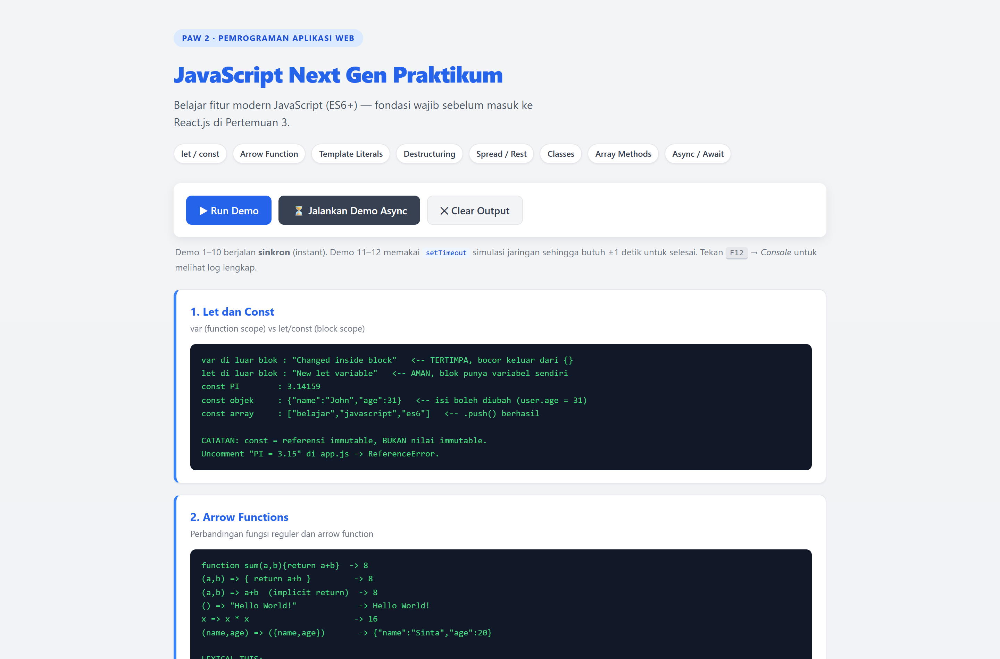
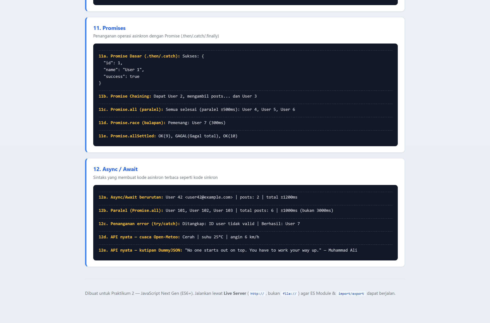

# JavaScript Next Gen (ES6+) — Praktikum Pertemuan 2

> **Farid Rizky Fauzan** · NIM **124140210** · Pemrograman Aplikasi Web (PAW)
> Repository: [`zann06/pemrograman_web_itera_124140210`](https://github.com/zann06/pemrograman_web_itera_124140210)
> **Demo langsung (GitHub Pages):** <https://zann06.github.io/pemrograman_web_itera_124140210/faridrizkyfauzan_124140210_pertemuan2/01-praktikum-js-nextgen/index.html>
> **Repository:** <https://github.com/zann06/pemrograman_web_itera_124140210>


Demo interaktif 12 fitur JavaScript Modern (ES6+) yang menjadi fondasi sebelum masuk ke **Pertemuan 3 — React.js**.

> **Mata kuliah:** Pemrograman Aplikasi Web 2
> **Topik:** Mengenal JavaScript Modern (ES6+)

---

## 📌 Daftar Isi

1. [Ringkasan Fungsi Aplikasi](#-ringkasan-fungsi-aplikasi)
2. [Fitur yang Didemokan](#-fitur-yang-didemokan)
3. [Struktur Project](#-struktur-project)
4. [Cara Menjalankan](#-cara-menjalankan)
5. [Penjelasan File](#-penjelasan-file)
6. [Ringkasan tiap Demo](#-ringkasan-tiap-demo)
7. [Fitur ES6+ per Baris Kode](#-fitur-es6-per-baris-kode)
8. [Catatan Penting (Error yang Sering Terjadi)](#-catatan-penting-error-yang-sering-terjadi)
9. [Latihan Mandiri](#-latihan-mandiri)
10. [Screenshot](#-screenshot)
11. [Push ke GitHub](#-push-ke-github)
12. [Kriteria Penilaian](#-kriteria-penilaian)

---

## 🎯 Ringkasan Fungsi Aplikasi

Aplikasi web statis satu halaman (**SPA tanpa framework**) yang berfungsi sebagai **lab demo JavaScript modern**.

Ketika tombol **▶ Run Demo** ditekan, aplikasi menjalankan **10 demo sinkron** secara berurutan dan menampilkan hasilnya sebagai kartu-kartu di layar. Tombol **⏳ Jalankan Demo Async** menjalankan **2 demo asinkron** (Promise & Async/Await) yang mensimulasikan proses pengambilan data dari server.

Setiap output sengaja ditampilkan dalam format `console`-like (`<pre>` berwarna hijau di atas latar gelap) agar mahasiwa bisa langsung membandingkan **cara lama vs cara modern** berdampingan.

### Armandek

| Tombol | Fungsi |
|---|---|
| **▶ Run Demo** | Menjalankan demo 1–10 (sinkron, instan) + kartu ringkasan 12 topik |
| **⏳ Jalankan Demo Async** | Menjalankan demo 11–12 (asinkron, ±1 detik, termasuk API publik nyata) |
| **✕ Clear Output** | Mengosongkan seluruh kartu output |

---

## 🚀 Fitur yang Didemokan

| # | Topik | Fitur ES6+ Utama |
|---|---|---|
| 1 | Let dan Const | `let`, `const`, block scope, TDZ |
| 2 | Arrow Functions | `=>`, implicit return, lexical `this` |
| 3 | Template Literals | `` ` `` backtick, `${}`, multi-baris string |
| 4 | Destructuring | Object/array destructuring, nested, rest pattern, swap |
| 5 | Spread & Rest | `...` spread, rest parameter, shallow copy |
| 6 | Default Parameters | `param = nilai`, default dari parameter lain |
| 7 | Classes | `class`, `constructor`, `extends`, `super`, getter/setter, static, `#private` |
| 8 | Enhanced Object Literals | Property shorthand, method shorthand, computed property |
| 9 | Modern Array Methods | `map`, `filter`, `find`, `findIndex`, `some`, `every`, `reduce`, chaining |
| 10 | Advanced Arrays | `Array.from`, `Array.of`, `flat`, `flatMap`, `includes`, `at`, `findLast`, `structuredClone`, `for...of` |
| 11 | Promises | `new Promise`, `.then`, `.catch`, `.finally`, `Promise.all`, `Promise.race`, `Promise.allSettled` |
| 12 | Async / Await | `async`, `await`, `try/catch`, paralel via `Promise.all`, integrasi API nyata |

**Fitur ES6+ di luar daftar/topik wajib (bonus):**
- ES Modules (`import` / `export`) untuk seluruh kode
- Private class fields (`#secret`) — ES2022
- Nullish coalescing (`??`) dan optional chaining (`?.`)
- `Intl.NumberFormat` untuk format Rupiah
- API publik gratis: **Open-Meteo** (cuaca) dan **DummyJSON** (kutipan)

---

## 📁 Struktur Project

```
pemrograman_web_itera_124140210/          # root repository GitHub
└── faridrizkyfauzan_124140210_pertemuan2/               # folder per pertemuan
    └── 01-praktikum-js-nextgen/
        ├── index.html                 # Halaman utama + tombol interaktif
        ├── README.md                  # File ini
        ├── LICENSE                    # Lisensi MIT
        ├── .gitignore                 # Abaikan file OS/editor
        ├── css/
        │   └── style.css              # Styling kustom (tanpa framework)
        └── js/
            ├── main.js                # Entry point / DOM controller
            ├── app.js                 # 12 fungsi demo ES6+
            └── modules/
                ├── data.js            # Sumber data: sampleUsers, sampleProducts, apiConfig
                └── utils.js           # Helper: formatRupiah, capitalize, dll
```

---

## ▶️ Cara Menjalankan

### ⚠️ WAJIB Live Server

**Jangan** membuka `index.html` dengan double-click (protokol `file://`). Browser memblokir proses `import` modul karena batasan keamanan **CORS**.

### Langkah

1. Buka folder `faridrizkyfauzan_124140210_pertemuan2/01-praktikum-js-nextgen` di **VS Code**.
2. Install extension **Live Server** (Ritwick Dey) jika belum ada.
3. Klik kanan `index.html` di Explorer → **Open with Live Server**.
4. Browser membuka `http://127.0.0.1:5500/index.html`.
5. Klik **▶ Run Demo**.

### Alternatif tanpa VS Code

```bash
# Mengenix
cd faridrizkyfauzan_124140210_pertemuan2/01-praktikum-js-nextgen
npx serve .

# Python
cd faridrizkyfauzan_124140210_pertemuan2/01-praktikum-js-nextgen
python -m http.server 5500
# lalu buka http://localhost:5500
```

> **Syarat:** Browser **Chrome/Edge/Firefox versi 90+** (butuh `structuredClone`, `findLast`, private field).

---

## 📖 Penjelasan File

### `index.html`
Halaman utama. Memuat CSS, menampilkan header + chip daftar topik, ketiga tombol, dan wadah `<div id="output">`.

```html
<!-- Atribut type="module" WAJIB ada agar import/export ES6 berjalan -->
<script type="module" src="js/main.js"></script>
```

### `css/style.css`
Styling kustom murni CSS (tanpa Tailwind CDN) memakai **CSS custom properties** sebagai design token. Termasuk mode responsif untuk layar < 640px dan `prefers-reduced-motion`.

### `js/modules/data.js`
Modul data. Mengekspor `sampleUsers`, `sampleProducts`, dan `apiConfig` (URL API publik gratis).

### `js/modules/utils.js`
Modul helper. Semua fungsi ditulis dengan **arrow function** satu-liners + **implicit return**:
`formatRupiah`, `capitalize`, `truncate`, `toTitleCase`, `formatList`, `prettyJSON`.

### `js/app.js`
Inti modul. Berisi **12 fungsi demo** yang masing-masing mengembalikan objek hasil (bukan langsung mencetak ke layar). Prinsipnya: **fungsi demo murni & mudah diuji**.

### `js/main.js`
Entry point. Mengimpor semua fungsi demo, menyediakan `addOutput()` untuk merender kartu, lalu menghubungkan event klik tombol.

---

## 🧪 Ringkasan Tiap Demo

### Demo 1 — Let dan Const
Membuktikan **scope leakage** `var` vs `let`, serta perbedaan `const` (referensi immutable, isi tetap bisa diubah).

```js
var oldVar = "Old variable";
{ var oldVar = "Changed inside block"; }   // ← variabel luar TERTIMPA
console.log(oldVar); // "Changed inside block"

let newLet = "New let variable";
{ let newLet = "Different..."; }          // ← berdiri sendiri, aman
console.log(newLet); // "New let variable"

const PI = 3.14159;
// PI = 3.15;   // ReferenceError!
const user = { name: "John", age: 30 };
user.age = 31;   // ✅ valid — isi objek const bisa diubah
```

### Demo 2 — Arrow Functions
Membandingkan 6 variasi sintaks arrow function + menjelaskan **lexical `this`**.

```js
const sum1 = (a, b) => { return a + b; };  // body blok
const sum2 = (a, b) => a + b;              // implicit return
const createUser = (name, age) => ({ name, age }); // objek WAJIB dibungkus kurung
const square = x => x * x;                 // 1 param -> kurung opsional
const sayHello = () => "Hello World!";     // 0 param -> kurung wajib
```

### Demo 3 — Template Literals
Concatenation vs template literal, string multi-baris tanpa `\n`, dan **merender kartu HTML produk** dari data modul.

```js
const greeting = `Halo, ${name}! Anda berumur ${age} tahun.`;
// tahun lahir dihitung on-the-fly:
`Tahun lahir: ${new Date().getFullYear() - age}`
```

### Demo 4 — Destructuring
Termasuk **nested 3 level** dan ekstraksi dari "API response".

```js
const { address: { geo: { lat, lng } } } = person;
const [, , thirdColor] = colors;      // lewati 2 elemen pertama
const [a, b] = [b, a];                // swap tanpa variabel temp
```

### Demo 5 — Spread & Rest
Membuktikan **shallow copy** secara konkret dan menunjukkan pola `({ name, role }) => ...` yang dipakai React.

```js
const extended = { ...person, email: "x@y.z", age: 31 }; // age di-override
const sum = (...nums) => nums.reduce((t, n) => t + n, 0);

// Bukti shallow copy:
const original = { profile: { city: "Jakarta" } };
const clone = { ...original };
clone.profile.city = "Bandar Lampung";
console.log(original.profile.city); // "Bandar Lampung" ← ikut berubah!
```

### Demo 6 — Default Parameters
Membuktikan **bug operator `||`** dengan nilai falsy (`0` dan `""`).

```js
function greetOld(name, greeting) { name = name || "Guest"; /* ... */ }
function greet(name = "Guest", greeting = "Hello") { /* ... */ }

greetOld(0, "")  // "Hello, Guest!"  ← salah, 0 & "" valid
greet(0, "")     // "Hello, 0!"     ← benar
```

### Demo 7 — Classes
`class User`, `class Admin extends User`, `class Guest extends User`, **getter/setter**, **static factory**, **override + `super()`**, dan **private field `#secret`**.

### Demo 8 — Enhanced Object Literals
Property shorthand, method shorthand, computed property names (statis & dinamis).

```js
const newPerson = {
  name, age,                     // shorthand
  sayHello() { return "Hello!"; }, // method shorthand
  ["skill_" + 1]: "JavaScript"    // computed property
};
```

### Demo 9 — Modern Array Methods
Seluruh higher-order function: `map`, `filter`, `find`, `findIndex`, `some`, `every`, `reduce` (sum/product/max/min/groupBy), dan **method chaining**.

### Demo 10 — Advanced Arrays
`Array.from`, `Array.of`, `flat`, `flatMap`, `includes`, `at(-1)`, `findLast`, `structuredClone`, `for...of` + destructuring.

### Demo 11 — Promises
5 skenario: `.then/.catch`, **chaining** (kembalikan Promise baru dari dalam `.then()`), `Promise.all`, `Promise.race` dengan timeout, dan `Promise.allSettled`.

### Demo 12 — Async / Await
- **Berurutan** (`await` satu per satu → ±1200ms)
- **Paralel** (`Promise.all` → ±1000ms, bukan 3000ms)
- **Penanganan error** `try/catch`
- **Integrasi API publik nyata**: cuaca [Open-Meteo](https://api.open-meteo.com) & kutipan [DummyJSON](https://dummyjson.com)

> Baris 12d & 12e membutuhkan **koneksi internet**. Jika gagal, aplikasi menampilkan pesan fallback, bukan error fatal.

---

## 🔍 Fitur ES6+ per Baris Kode

Untuk keperluan laporan/dokumentasi. **Seluruh nomor baris di bawah sudah diverifikasi otomatis** terhadap kode sumber menggunakan pencarian literal — bukan tebakan. Gunakan **Ctrl+G** di VS Code untuk melompat langsung ke baris tersebut.

> ⚠️ **Kalau kamu mengubah kode**, nomor baris bisa bergeser. Gunakan **Ctrl+F** untuk memverifikasi ulang.

#### Ringkasan jumlah

Dihitung otomatis dari tabel di bawah. Satu baris kode bisa masuk lebih dari satu kategori, jadi jumlahnya tidak saling menjumlah.

| Fitur ES6+ | Jumlah Lokasi Terverifikasi |
|---|---:|
| Array Methods (`map`/`filter`/`find`/`reduce`/chaining/`flat`/`at`) | 21 |
| Async Programming (`Promise`/`async`/`await`) | 14 |
| Classes (`class`/`extends`/`super`/getter/setter/static/`#private`) | 13 |
| Arrow Functions | 10 |
| Destructuring | 10 |
| Spread & Rest | 8 |
| ES Modules (`import` / `export`) | 7 |
| Template Literals | 5 |
| Default Parameters | 5 |
| Enhanced Object Literals | 4 |
| `let` / `const` | 4 |
| **TOTAL entri terverifikasi** | **96** |

#### Sebaran per File

| File | Entri | Isi utama |
|---|---:|---|
| `js/app.js` | 88 | 12 fungsi demo ES6+ |
| `js/main.js` | 5 | Entry point + import modul |
| `js/modules/utils.js` | 2 | Arrow function helper |
| `js/modules/data.js` | 1 | `export const` data contoh |

#### Tabel Lengkap

| Baris | File | Fitur / Konsep |
|:---:|---|---|
| `  28` | `js/app.js` | let - variabel block-scoped |
| `  35` | `js/app.js` | const - nilai tidak bisa di-reassign |
| `  36` | `js/app.js` | const - objek, isi bisa diubah |
| `  42` | `js/app.js` | const array + mutasi isi |
| `  64` | `js/app.js` | arrow dengan body blok |
| `  69` | `js/app.js` | arrow implicit return |
| `  72` | `js/app.js` | arrow tanpa parameter |
| `  75` | `js/app.js` | arrow 1 parameter (kurung opsional) |
| `  78` | `js/app.js` | arrow return objek literal |
| ` 479` | `js/app.js` | let/const di scope fungsi |
| ` 491` | `js/app.js` | arrow callback map() |
| ` 494` | `js/app.js` | arrow callback filter() |
| `  12` | `js/modules/utils.js` | arrow helper di modul |
| `  25` | `js/modules/utils.js` | arrow helper di modul |
| ` 382` | `js/main.js` | arrow event handler |
| ` 119` | `js/app.js` | interpolasi variabel |
| ` 122` | `js/app.js` | string multi-baris tanpa \n |
| ` 131` | `js/app.js` | ekspresi di dalam ${} |
| ` 139` | `js/app.js` | render HTML kartu produk |
| `  54` | `js/main.js` | render kartu output |
| ` 166` | `js/app.js` | object destructuring dasar |
| ` 169` | `js/app.js` | ganti nama variabel |
| ` 172` | `js/app.js` | nilai default |
| ` 175` | `js/app.js` | nested 3 level |
| ` 179` | `js/app.js` | array destructuring |
| ` 182` | `js/app.js` | skip elemen |
| ` 185` | `js/app.js` | rest pattern |
| ` 190` | `js/app.js` | swap variabel |
| ` 198` | `js/app.js` | destructure dari API response |
| ` 257` | `js/app.js` | destructure di parameter fungsi |
| ` 222` | `js/app.js` | spread array |
| ` 223` | `js/app.js` | copy array |
| ` 227` | `js/app.js` | merge array |
| ` 229` | `js/app.js` | spread sebagai argumen |
| ` 233` | `js/app.js` | copy objek |
| ` 235` | `js/app.js` | spread objek + override |
| ` 243` | `js/app.js` | shallow copy |
| ` 248` | `js/app.js` | rest parameter |
| ` 252` | `js/app.js` | rest + parameter biasa |
| ` 287` | `js/app.js` | default sederhana |
| ` 292` | `js/app.js` | default berisi ekspresi |
| ` 297` | `js/app.js` | default merujuk parameter lain |
| ` 302` | `js/app.js` | default + destructuring |
| ` 330` | `js/app.js` | deklarasi class |
| ` 331` | `js/app.js` | private field (ES2022) |
| ` 333` | `js/app.js` | constructor |
| ` 339` | `js/app.js` | method |
| ` 347` | `js/app.js` | getter |
| ` 351` | `js/app.js` | setter |
| ` 363` | `js/app.js` | static method / factory |
| ` 368` | `js/app.js` | inheritance (extends) |
| ` 370` | `js/app.js` | memanggil constructor parent |
| ` 375` | `js/app.js` | override method memakai super() |
| ` 438` | `js/app.js` | object literal modern |
| ` 441` | `js/app.js` | method shorthand |
| ` 444` | `js/app.js` | computed property names |
| ` 452` | `js/app.js` | computed property dinamis |
| ` 490` | `js/app.js` | map() |
| ` 495` | `js/app.js` | filter() |
| ` 498` | `js/app.js` | find() |
| ` 499` | `js/app.js` | findIndex() |
| ` 502` | `js/app.js` | some() |
| ` 503` | `js/app.js` | every() |
| ` 506` | `js/app.js` | reduce() sum |
| ` 507` | `js/app.js` | reduce() product |
| ` 516` | `js/app.js` | reduce() groupBy |
| ` 524` | `js/app.js` | method chaining filter -> map |
| ` 538` | `js/app.js` | flatten via reduce |
| ` 566` | `js/app.js` | Array.from() |
| ` 567` | `js/app.js` | Array.from() + mapFn |
| ` 574` | `js/app.js` | struktur bersarang |
| ` 576` | `js/app.js` | flat(2) |
| ` 577` | `js/app.js` | flatMap() |
| ` 584` | `js/app.js` | at() indeks negatif |
| ` 588` | `js/app.js` | findLast() |
| ` 591` | `js/app.js` | structuredClone() |
| ` 628` | `js/app.js` | constructor Promise |
| ` 657` | `js/app.js` | .then()/.catch() |
| ` 678` | `js/app.js` | .finally() |
| ` 670` | `js/app.js` | chaining (kembalikan Promise baru) |
| ` 681` | `js/app.js` | Promise.all() |
| ` 691` | `js/app.js` | Promise.race() |
| ` 706` | `js/app.js` | Promise.allSettled() |
| ` 769` | `js/app.js` | async function |
| ` 771` | `js/app.js` | await |
| ` 786` | `js/app.js` | async paralel |
| ` 788` | `js/app.js` | map -> Promise.all (paralel) |
| ` 789` | `js/app.js` | await Promise.all tahap kedua |
| ` 805` | `js/app.js` | async + try/catch |
| ` 820` | `js/app.js` | fetch API nyata |
| ` 822` | `js/app.js` | parse JSON |
| `   8` | `js/modules/data.js` | export const (modul data) |
| `  20` | `js/app.js` | export function |
| `  31` | `js/main.js` | import named |
| `  33` | `js/main.js` | import dari utils |
| ` 413` | `js/main.js` | re-export |
---

---

## ⚠️ Catatan Penting (Error yang Sering Terjadi)

### 1. Error: `Uncaught SyntaxError: Cannot use import statement outside a module`
**Penyebab:** `<script>` tidak memakai `type="module"`.
**Solusi:** Ubah menjadi `<script type="module" src="js/main.js"></script>`.

### 2. Error: `Access to script at 'file:///...' from origin 'null' has been blocked by CORS policy`
**Penyebab:** Membuka `index.html` langsung lewat double-click (protokol `file://`).
**Solusi:** Jalankan via **Live Server**.

### 3. Error: `Uncaught ReferenceError: PI is not defined` / `Assignment to constant variable`
**Penyebab:** Percobaan reassign `const`. **Ini memang demo yang disengaja.**
**Solusi:** Buka Console, lihat error. Lalu kembalikan seperti semula.

### 4. `structuredClone is not defined` / `findLast is not an arrow function`
**Penyebab:** Browser versi lama.
**Solusi:** Update ke Chrome/Edge/Firefox versi 90+.

### 5. Demo 12 baris 12d & 12e gagal
**Penyebab:** Tidak ada koneksi internet.
**Solusi:** Aplikasi akan menampilkan pesan fallback yang ramah — bukan crash. Klik ulang saat online.

---

## 📝 Latihan Mandiri

### Level 1 — Pemahaman
- [ ] Bandingkan output `var` dan `let` di Demo 1. Jelaskan mengapa nilainya berbeda.
- [ ] Comment baris `PI = 3.15;` di `js/app.js`, klik Run Demo, amati error di Console.
- [ ] Ubah `user.age = 31` menjadi `user = { name: "X" }`. Apakah ini error? Mengapa?

### Level 2 — Menulis Kode
- [ ] Destructure object dengan **nested properties minimal 3 level** (lihat `person.address.geo`).
- [ ] Buat fungsi yang menerima **rest parameters** dan mengembalikan statistik `{ min, max, average }`.
- [ ] Buat **4 variasi arrow function** dengan sintaks berbeda untuk fungsi yang sama.
- [ ] Gunakan template literals untuk membuat **HTML string** kartu produk dari `sampleProducts`.

### Level 3 — Manipulasi Data
- [ ] **Merge 3 object** dengan spread operator dan override beberapa properti.
- [ ] Gunakan destructuring di dalam loop `for...of`.
- [ ] Implementasikan fungsi `groupBy(array, key)` menggunakan `reduce`.
- [ ] Hitung rata-rata dari array of objects menggunakan `reduce`.
- [ ] Ubah array bersarang `[1,[2,3],[[4,5],6]]` menjadi array datar.

### Level 4 — Async
- [ ] Ubah `demoAsyncAwait()` agar membandingkan **kecepatan** sequential vs paralel dengan `performance.now()`.
- [ ] Tambahkan **Promise.race** dengan timeout 300ms pada `fetch` API cuaca.
- [ ] Buat tampilan **loading state** (spinner) selama proses async berlangsung.
- [ ] Ambil data dari **3 API berbeda** sekaligus lalu gabungkan dengan `Promise.all`.

### Tantangan — Bereksperimen
- [ ] Tambahkan **getter/setter** pada class `User` yang menyimpan `_age` dan memvalidasi input.
- [ ] Buat class `Product` → `DigitalProduct` & `PhysicalProduct` (inheritance).
- [ ] Buat `tagged template function` untuk menandai string sebagai "aman" (escape HTML).
- [ ] Tulis ulang seluruh demo dengan **IIFE module pattern** lalu bandingkan dengan ES Module.

---

## 📸 Screenshot

> Diambil otomatis dengan Chrome headless (`puppeteer-core`) pada 1440×950, 2× scale.
> Baris **12d** dan **12e** memakai data nyata dari API publik (Open-Meteo & DummyJSON).

| Demo sinkron — 10 topik ES6+ | Seluruh output (halaman penuh) | Demo async — Promise & Async/Await |
|---|---|---|
|  |  |  |


## 🚀 Push ke GitHub

### Persiapan (sekali saja)

```bash
# Cek apakah Git sudah terinstall
git --version

# Konfigurasi identitas (WAJIB agar commit tidak ditolak)
git config --global user.name "Nama Lengkap Kamu"
git config --global user.email "email@github.com"
```

### Membuat Repository di GitHub

1. Buka <https://github.com/new>
2. **Repository name**: `pemrograman_web_itera_124140210`
3. **Public** (agar bisa diakses dosen)
4. ⚠️ **JANGAN** centang "Add a README file" / `.gitignore` / license (bisa konflik)
5. Klik **Create repository**

### Push dari Laptop

```bash
# 1. Masuk ke folder project
cd pemrograman_web_itera_124140210

# 2. Inisialisasi git
git init

# 3. Masukkan semua file ke staging area
git add .

# 4. Commit pertama
git commit -m "feat: implementasi 12 demo JavaScript Next Gen (ES6+)"

# 5. Tentukan branch utama
git branch -M main

# 6. Hubungkan ke repository GitHub
git remote add origin https://github.com/zann06/pemrograman_web_itera_124140210.git

# 7. Kirim ke GitHub
git push -u origin main
```

Saat diminta kredensial:
- **Username**: username GitHub kamu
- **Password**: gunakan **Personal Access Token**, bukan password biasa

### Membuat Personal Access Token

1. GitHub → Settings → Developer settings → **Personal access tokens** → **Tokens (classic)**
2. Klik *Generate new token (classic)*
3. Centang **`repo`**
4. Terapkan → salin token (hanya ditampilkan sekali)

### Perintah Git Sehari-hari

```bash
git status              # cek perubahan
git add .               # stage semua perubahan
git commit -m "pesan"    # commit
git push                # kirim ke GitHub
git pull                # ambil perubahan dari GitHub

# Melihat riwayat
git log --oneline --graph --all
```

### Kalau Sudah Punya Repository (skip langkah `git init`)

```bash
git remote -v                      # cek remote yang ada
git remote set-url origin https://github.com/zann06/pemrograman_web_itera_124140210.git
git branch -M main
git push -u origin main
```

### Deploy Gratis ke GitHub Pages (opsional, bonus nilai)

1. GitHub → repository → **Settings** → **Pages**
2. **Source**: `Deploy from a branch` → branch `main`, folder `/ (root)`
3. Klik **Save**, tunggu ±1 menit
4. Akses: `https://zann06.github.io/pemrograman_web_itera_124140210/faridrizkyfauzan_124140210_pertemuan2/`

> Ticker **Settings → Pages** butuh repository bersifat **Public**.

### Troubleshooting

| Masalah | Solusi |
|---|---|
| `remote origin already exists` | `git remote set-url origin <url>` |
| `rejected: non-fast-forward` | `git pull origin main --rebase` lalu `git push` |
| `Permission denied (publickey)` | Gunakan HTTPS, bukan SSH |
| `Please tell me who you are` | Jalankan `git config --global user.email "..."` |
| Fatal: could not read Username | Masukkan username GitHub + Personal Access Token |
| Struktur folder berantakan | `git add .` **dari dalam folder project**, bukan dari folder induk |

---

## 🧪 Riwayat Pengujian Internal

Seluruh output demo diverifikasi otomatis sebelum dikirim:

| Suite Pengujian | Cakupan | Hasil |
|---|---|---:|
| Fungsi demo (12 topik) | Nilai balik setiap `demoXxx()` diperiksa terhadap nilai yang diharapkan | **101/101 lulus** |
| Validasi sintaks | `node --check` untuk 11 file `.js` | **11/11 valid** |

**Yang diperiksa antara lain:**

- `var` benar-benar bocor keluar blok, `let` benar-benar terisolasi
- `const` objek bisa diubah isinya, tapi `PI` tidak bisa di-reassign
- Arrow function implicit return menghasilkan nilai sama dengan versi `function`
- Destructuring: nested 3 level, skip elemen, rest pattern, dan swap variabel
- Shallow copy terbukti benar-benar berbagi referensi pada nested object
- Bug klasik `||` dengan nilai falsy (`0`, `""`)vs default parameter
- `instanceof` benar untuk hierarki `User` → `Admin` / `Guest`
- `reduce` menghasilkan sum 55, product 3628800, max 10, min 1, dan groupBy role
- `flat(2)`, `flatMap`, `at(-1)`, `findLast`, `structuredClone` sesuai spesifikasi

---
## 📊 Kriteria Penilaian (Acuan)

| Aspek | Bobot | Yang Harus Ditunjukkan |
|---|---|---|
| **Fungsionalitas & interaktivitas** | 30% | Ketiga tombol berfungsi; output lengkap & terbaca; demo async benar-benar berubah dari "Memuat..." ke hasil |
| **Implementasi fitur ES6+** | 25% | 12 demo berjalan; jelas mana "cara lama" vs "cara modern"; ada penjelasan di dalam output |
| **Penyimpanan & pengelolaan data** | 20% | — (bers geared ke Tugas, lihat paket 2) |
| **Desain UI/UX** | 15% | Tampilan rapi, responsif, kontras warna baik, ada feedback (loading state) |
| **Dokumentasi & kerapian kode** | 10% | README lengkap, kode terstruktur modular, komentar jelas, tidak ada kode mati |

### Tips Menambah Nilai

- ✅ Pisahkan setiap konsep ke fungsi demo tersendiri (sudah dilakukan)
- ✅ Tambahkan komentar penjelas pada kode yang "menakutkan" (misal `super()`, shallow copy)
- ✅ Bandingkan **cara lama vs cara modern** secara eksplisit di output
- ✅ Tangani kondisi gagal (API offline) dengan pesan ramah, bukan crash
- ✅ Format commit message dengan jelas (`feat:`, `docs:`, `fix:`)
- ✅ Tambahkan screenshot di README
- ✅ Deploy ke GitHub Pages supaya dosen bisa akses langsung

---

## 📚 Referensi

- [MDN — JavaScript Guide](https://developer.mozilla.org/en-US/docs/Web/JavaScript/Guide)
- [MDN — Array.prototype.at()](https://developer.mozilla.org/en-US/docs/Web/JavaScript/Reference/Global_Objects/Array/at)
- [MDN — structuredClone()](https://developer.mozilla.org/en-US/docs/Web/API/Window/structuredClone)
- [javascript.info — Modern JavaScript Tutorial](https://javascript.info/)
- [JSEP — Mozilla Explore](https://explore.mozilla.org/en-US/?q=javascript)
- [Open-Meteo Documentation](https://open-meteo.com/en/docs)
- [DummyJSON](https://dummyjson.com/)

---

## 📄 Lisensi

Dibuat untuk keperluan pembelajaran akademik. Bebas digunakan & dimodifikasi untuk keperluan tugas kuliah.

**Dibuat dengan ❤ untuk Praktikum PAW 2**