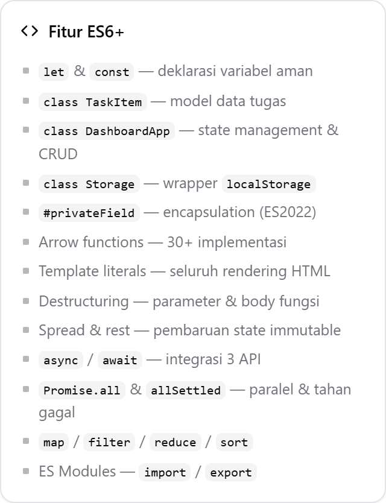

# 📊 Student Dashboard — Tugas Praktikum Pertemuan 2

> **Farid Rizky Fauzan** · NIM **124140210** · Pemrograman Aplikasi Web (PAW)
> Repository: [`zann06/pemrograman_web_itera_124140210`](https://github.com/zann06/pemrograman_web_itera_124140210)
> **Demo langsung (GitHub Pages):** <https://zann06.github.io/pemrograman_web_itera_124140210/faridrizkyfauzan_124140210_pertemuan2/02-tugas-personal-dashboard/index.html>
> **Repository:** <https://github.com/zann06/pemrograman_web_itera_124140210>


**Personal Dashboard** untuk mahasiswa: kelola tugas, catatan, jadwal kuliah, cuaca real-time, dan kutipan motivasi harian — semuanya dibangun dari nol menggunakan **JavaScript Modern (ES6+)** tanpa framework.

> **Mata kuliah:** Pemograman Aplikasi Web 2
> **Tugas:** Personal Dashboard (Produktivitas Mahasiswa)
> **Topik:** Mengenal JavaScript Modern (ES6+) — Classes, Async/Await, localStorage

---

## 📌 Daftar Isi

1. [Konsep & Tantangan Kreatif](#-konsep--tantangan-kreatif)
2. [Fitur Aplikasi](#-fitur-aplikasi)
3. [Screenshot](#-screenshot)
4. [Cara Menjalankan](#-cara-menjalankan)
5. [Struktur Project](#-struktur-project)
6. [Arsitektur Kode](#-arsitektur-kode)
7. [Penjelasan File](#-penjelasan-file)
8. [Daftar Fitur ES6+ per Baris Kode](#-daftar-fitur-es6-per-baris-kode)
9. [Pemenuhan Syarat Tugas](#-pemenuhan-syarat-tugas)
10. [Kriteria Penilaian & Strategi](#-kriteria-penilaian--strategi)
11. [Catatan Penting / Troubleshooting](#-catatan-penting--troubleshooting)
12. [Ide Pengembangan Lanjutan](#-ide-pengembangan-lanjutan)
13. [Push ke GitHub](#-push-ke-github)
14. [Referensi](#-referensi)

---

## 💡 Konsep & Tantangan Kreatif

### Latar Belakang

Mahasiswa umumnya punya masalah yang **sama berulang setiap semester**: tugas menumpuk, tenggat terlewat, jadwal kuliah bentrok, dan ide-ide catatan tercecer di kertas atau chat pribadi. Aplikasi **Student Dashboard** menjawab masalah itu secara spesifik — bukan sekadar "to-do list generik".

### Apa Bedanya dari To-Do List Umum?

| Keunggulan Student Dashboard |
|---|
| 🧑‍🎓 **Konteks mahasiswa** — kategori `Tugas / Ujian / Proyek / Bacaan / Pribadi`, bukan "Work / Home / Other" |
| 🌤️ **Cuaca kampus real-time** —(--) taken dari koordinat ITERA, Lampung, untuk memutuskanbrella saat berangkat |
| 🎓 **Jadwal kuliah** — dengan penanda "Hari ini" otomatis, bukan kalender kosong |
| 💬 **Kutipan motivasi** — header yang berubah tiap klik, untuk memulai sesi belajar |
| 📊 **Statistik relevan** — progres penyelesaian + distribusi per kategori |
| ⏰ **Deteksi otomatis keterlambatan** — badge "Terlambat 3 hari" tanpa harus dihitung manual |
| 💾 **Data lokal & privat** — tidak ada akun, tidak ada server, data tidak pernah meninggalkan browser |
| 🔁 **Seeding dari API** — kali pertama dibuka, 6 tugas contoh otomatis terisi dari JSONPlaceholder |

### Tema Visual: shadcn/ui + Tanpa Emoji

Antarmuka mengikuti **[shadcn/ui](https://ui.shadcn.com/)** — yang sebenarnya
hanya kumpulan class + token warna, bukan library. Di sini pola yang sama
diterapkan murni dengan CSS tanpa framework.

**Design token** — semua warna adalah custom property HSL semantik di satu blok:

```css
:root {
  --background:       0 0% 100%;       /* card & halaman        */
  --foreground:       240 10% 3.9%;    /* teks utama            */
  --muted:            240 4.8% 95.9%;  /* latar generator       */
  --muted-foreground: 240 3.8% 46.1%;  /* teks sekunder         */
  --border:           240 5.9% 90%;    /* garis 1px             */
  --primary:          240 5.9% 10%;    /* netral gelap          */
  --destructive:      0 72.2% 50.6%;   /* hanya aksi destruktif */
  --radius: 8px;
}
```

Mengganti tema (misalnya ke dark mode) cukup menulis ulang nilai-nilai ini —
tidak ada warna yang ditulis langsung di dalam komponen.

**Ciri khas yang diimiterasi:**

| Aspek | shadcn/ui | Implementasi di sini |
|---|---|---|
| Warna | Abu-abu netral | Token HSL di atas |
| Border | Tipis 1px, radius 8px | `border: 1px solid hsl(var(--border))` |
| Shadow | Sangat subtle | 4 tingkat, opacity 0.05 - 0.12 |
| Tipografi | Inter, padat | 13.5px, `line-height: 1.55` |
| Tombol | 32px, variant primary / outline / ghost | Modifier class `btn--primary`, `btn--outline`, `btn--ghost` |
| Badge | Pil kecil, warna lembut | `data-tone` + palet HSL |
| Ikon | Lucide, 24x24 stroke 2 | `js/modules/icons.js` |

### Kenapa Emoji Diganti SVG

Aplikasi ini **semuanya tanpa emoji** (sudah diverifikasi otomatis: 0 kemunculan
di seluruh file HTML, CSS, dan JS).

1. **Tampilan berbeda antar OS** — emoji di Windows, macOS, dan Android punya
   gaya berbeda, sehingga desain tidak konsisten.
2. **Warnanya mencolok** — sulit diseimbangkan dengan palet netral shadcn.
3. **Tidak bisa di-style** — SVG memakai `stroke: currentColor` sehingga ikut
   warna teks induknya dan otomatis cocok bila tema diganti.
4. **Ukurannya seragam** — diatur lewat atribut `width` / `height`.

### `js/modules/icons.js`

Modul baru berisi **40+ ikon** bergaya Lucide dalam bentuk string, supaya bisa
dipakai langsung di dalam template literal:

```js
import { icon } from "./modules/icons.js";

icon("plus");                 // 16px, ukuran default
icon("trash", 14, "my-cls");  // 14px + class tambahan
```

Setiap ikon menghasilkan markup seperti ini:

```html
<svg class="icon" width="16" height="16" viewBox="0 0 24 24"
     fill="none" stroke="currentColor" stroke-width="2"
     stroke-linecap="round" stroke-linejoin="round" aria-hidden="true">...</svg>
```

Kalau nama ikon tidak dikenal, fungsi **tidak melempar error** — ia mengembalikan
ikon cadangan, sehingga satu salah ketik tidak bisa menjatuhkan aplikasi.

Untuk ikon pada HTML statis dipakai atribut `data-icon`, yang dihidrasi sekali
saat `init()` berjalan (lihat `hydrateIcons()` di `main.js`):

```html
<button class="btn btn--primary">
  <span data-icon="plus" data-size="14"></span> Tambah tugas
</button>
```

### Prinsip Desain

1. **Zero backend** — 100% vanilla JS + `localStorage`, mudah di-host di GitHub Pages.
2. **Offline-first** — aplikasi tetap berfungsi penuh tanpa internet (cuaca/kutipan saja yang butuh koneksi).
3. **Immutability** — semua perubahan state membuat objek baru, mudah dilacak & di-debug.
4. **Separation of concerns** — model, storage, API, view, dan controller terpisah.

---

## 🚀 Fitur Aplikasi

### Kelola Tugas (CRUD Lengkap)

| Fitur | Detail |
|---|---|
| ➕ **Tambah** | Modal form dengan validasi judul |
| ✏️ **Edit** | Modal terisi data lama,(ID sama dipertahankan) |
| 🗑️ **Hapus** | Dengan dialog konfirmasi |
| ✅ **Toggle selesai** | Klik checkbox langsung berubah |
| 🧹 **Bersihkan selesai** | Hapus semua tugas yang sudah beres sekaligus |
| 🌐 **Isi dari API** | Impor 6 tugas contoh dari JSONPlaceholder |

### Pencarian, Filter & Sortir

- 🔍 Pencarian **live** (ketik langsung tersaring) pada judul + deskripsi
- 🏷️ Filter **kategori** (5 pilihan + Semua)
- 🎯 Filter **prioritas** (Tinggi/Sedang/Rendah + Semua)
- 📊 Filter **status** (Semua / Belum / Selesai / Terlambat)
- 🔀 **Sortir**: Tenggat, Prioritas, Judul A-Z, Terbaru

### Catatan Pribadi

- ➕ Tambah, ✏️ edit, 🗑️ hapus
- 5 pilihan warna (kuning, biru, hijau, pink, ungu) untuk klasifikasi visual
- Catatan terbaru otomatis tampil di paling atas

### Jadwal Kuliah

- ➕ Tambah slot (Hari, Jam, Mata Kuliah, Ruangan, Pengampu)
- 🗑️ Hapus slot
- **Otomatis terurut** berdasarkan hari (Senin→Minggu) lalu jam
- **Badge "Hari ini"** otomatis untuk slot hari berjalan

### Widget Async (Butuh Internet)

- 🌤️ **Cuaca real-time** dari **Open-Meteo** (kampus ITERA, Lampung) — lengkap dengan ikon, suhu, kecepatan angin, jam update
- 💬 **Kutipan motivasi** dari **DummyJSON** — tombol "Kutipan lain" mengambil yang baru

### Panel Data & Utilitas

- 📊 **4 kartu statistik**: total, selesai, belum, terlambat
- 📈 **Progress bar** + distribusi per kategori
- 💾 **Panel status localStorage**: jumlah item, jumlah key, ukuran KB, dan status fallback
- ⬇️ **Ekspor JSON** — unduh seluruh data sebagai backup
- 🗑️ **Reset Semua Data** — hapus total dengan konfirmasi ganda

### Pengalaman Pengguna

- ✨ **Toast notification** untuk setiap aksi (sukses/error/info)
- ⏳ **Loading state** dengan spinner saat data async dimuat
- 🛡️ **Penanganan error** — API gagal → pesan ramah, bukan crash
- 🖱️ **Modal** dengan tutup via tombol ✕, klik area gelap, atau tekan `Esc`
- 📱 **Responsif penuh** — desktop (2 kolom), tablet, & mobile (1 kolom)
- ♿ **Aksesibilitas** — `aria-label`, `role="dialog"`, navigasi keyboard, `prefers-reduced-motion`
- 🖨️ **Style cetak** — optimalkan halaman untuk di-print jadi PDF

---

## 📸 Screenshot

> Semua gambar di folder `docs/screenshots/` diambil otomatis dengan Chrome headless
> (`puppeteer-core`) pada **1440×900** (desktop, 2× scale) dan **390×844** (mobile).
> Data pada screenshot diambil dari **API publik sungguhan** — cuaca Open-Meteo,
> kutipan DummyJSON, dan 6 tugas dari JSONPlaceholder.

### 1. Dashboard utama (desktop)

Tampilan lengkap: profil, 4 kartu statistik, progress bar + distribusi kategori,
kutipan motivasi, daftar tugas, serta sidebar (cuaca, catatan, jadwal, panel storage).


### 2. Form tambah tugas (modal)

Bukti interaktif — modal dengan validasi judul, dropdown kategori/prioritas, dan date picker.


### 3. Pencarian + filter kategori aktif

Mencari kata kunci `tugas` **dan** memilih kategori "Tugas" sekaligus —
setiap kondisi filter diterapkan terpisah lalu digabung.


### 4. Widget async: cuaca, kutipan, jadwal

Cuaca real-time di Bandar Lampung dari **Open-Meteo**, kutipan dari **DummyJSON**,
dan jadwal kuliah dengan badge otomatis "Hari ini".


### 5. Panel penyimpanan lokal

Menampilkan status `localStorage`, jumlah item, jumlah key, dan ukuran data.


### 6. Ringkasan fitur ES6+ yang dipakai



### 7. Tampilan mobile (390×844)

Tata letak berubah menjadi satu kolom; seluruh fitur tetap berfungsi.


### Cara membuat ulang screenshot

Screenshot diambil dengan skrip otomatis agar konsisten. Untuk mengambil ulang
secara manual:

1. Jalankan aplikasi via **Live Server**
2. Tunggu API selesai termuat (±2 detik)
3. Tekan `Win + Shift + S` (Windows) atau `Cmd + Shift + 4` (Mac)
4. Simpan ke `docs/screenshots/` dengan nama yang sama
5. `Ctrl + F5` untuk memuat ulang halaman (hard refresh)

## ▶️ Cara Menjalankan

### ⚠️ WAJIB Live Server

**Jangan** buka `index.html` lewat double-click (protokol `file://`). Browser akan memblokir modul ES karena batasan **CORS** — hasilnya halaman kosong atau error di Console.

### Metode 1 — VS Code Live Server (Paling Mudah)

1. Buka folder `faridrizkyfauzan_124140210_pertemuan2/02-tugas-personal-dashboard` di VS Code.
2. Install extension **Live Server** (Ritwick Dey) dari Extensions marketplace.
3. Klik kanan `index.html` di Explorer → **Open with Live Server**.
4. Browser membuka `http://127.0.0.1:5500/index.html`.
5. **Tunggu ±2 detik** — widget cuaca & kutipan termuat dari internet.

### Metode 2 — Python

```bash
cd faridrizkyfauzan_124140210_pertemuan2/02-tugas-personal-dashboard
python -m http.server 5500
# buka http://localhost:5500
```

### Metode 3 — Node.js

```bash
cd faridrizkyfauzan_124140210_pertemuan2/02-tugas-personal-dashboard
npx serve .
```

### Syarat

| Kebutuhan | Keterangan |
|---|---|
| Browser | Chrome / Edge / Firefox versi **90+** (butuh `#privateField`, `?.`, `??`, `AbortController`) |
| Internet | **Wajib** untuk widget cuaca & kutipan. Fitur lain tetap jalan offline. |
| Server lokal | **Wajib** (Live Server / Python / Node) |

---

## 📁 Struktur Project

```
pemrograman_web_itera_124140210/          # root repository GitHub
└── faridrizkyfauzan_124140210_pertemuan2/               # folder per pertemuan
    └── 02-tugas-personal-dashboard/
        ├── index.html                  # Struktur halaman + 3 modal
        ├── README.md                   # File ini (dokumentasi lengkap)
        ├── LICENSE                     # Lisensi MIT
        ├── .gitignore                  # Abaikan file OS/editor
        ├── css/
        │   └── style.css               # Tema shadcn/ui (design token HSL)
        ├── docs/                       # Folder untuk screenshot laporan
        │   └── README-screenshots.txt  # Panduan nama file screenshot
        └── js/
            ├── main.js                 # Controller: event, modal, async orchestration
            ├── app.js                  # Renderer: semua template literal HTML
            └── modules/
                ├── classes.js          # class TaskItem & class DashboardApp
                ├── storage.js          # class Storage (wrapper localStorage)
                ├── api.js              # Async/Await + integrasi 3 API publik
                ├── icons.js            # 40+ ikon SVG gaya Lucide (pengganti emoji)
                ├── constants.js        # Konfigurasi terpusat (kategori, prioritas, endpoint)
                └── utils.js            # 15+ arrow function helper
```

---

## 🏗️ Arsitektur Kode

```
┌─────────────────────────────────────────────────────────┐
│                    index.html                           │
│              (struktur + elemen DOM)                    │
└────────────────────────┬────────────────────────────────┘
                         │
                         ▼
┌─────────────────────────────────────────────────────────┐
│                     main.js                             │
│                  UI CONTROLLER                          │
│  • Listener event (click, submit, input, change)        │
│  • Orkestrasi modal                                     │
│  • Pemanggilan fungsi async                              │
│  • Delegasi event (satu listener untuk banyak elemen)   │
└──────┬───────────────────────────┬──────────────────────┘
       │ mutate state              │ baca state
       ▼                           ▼
┌────────────────────┐   ┌────────────────────┐
│   classes.js       │   │      app.js        │
│  ⭐ DashboardApp   │   │   VIEW  RENDERER   │
│  ⭐ TaskItem       │   │  (semua template   │
│  ⭐ Storage        │   │     literal HTML)  │
└──────┬─────────────┘   └────────────────────┘
       │  baca/tulis
       ▼
┌────────────────────┐        ┌────────────────────┐
│   storage.js       │        │      api.js        │
│  localStorage      │        │  fetch + async/    │
│  (+ fallback RAM)  │        │  await + timeout   │
└────────────────────┘        └─────────┬──────────┘
                                         │
                                         ▼
                            ┌────────────────────────┐
                            │  API Publik (Gratis)   │
                            │  • Open-Meteo (cuaca)   │
                            │  • DummyJSON (kutipan)  │
                            │  • JSONPlaceholder (todo)│
                            └────────────────────────┘
```

### Prinsip yang Diterapkan

| Prinsip | Wujud di Kode |
|---|---|
| **Encapsulation** | State `#tasks`, `#notes`, `#schedule`, `#profile` adalah private field — hanya bisa diakses lewat method resmi (`addTask`, `removeTask`, dst.) |
| **Single Responsibility** | `storage.js` hanya urus persistensi · `api.js` hanya urus jaringan · `app.js` hanya urus tampilan · `main.js` hanya urus event |
| **Immutability** | Perubahan selalu `[...array, item]`, `{...state, patch}`, `.map()`, `.filter()` — tidak pernah `.push()` / `.sort()` langsung pada state |
| **Dependency Injection** | `DashboardApp` menerima modul `Storage` & konstanta sebagai import, bukan data hard-coded |
| **Fail-safe** | API gagal → fallback. localStorage diblokir → fallback in-memory. JSON rusak → nilai default. |
| **Observer Pattern** | `app.subscribe(fn)` memberi tahu UI setiap state berubah |

---

## 📖 Penjelasan File

### `js/modules/classes.js` ⭐ (File Paling Penting)

Berisi **2 class utama** sesuai arahan tugas:

#### `class TaskItem` — Model Data

```js
export class TaskItem {
  constructor({ title, id, description, category, priority, dueDate, completed }) {
    if (!title?.trim()) throw new Error("TaskItem: judul wajib diisi.");
    // ... inisialisasi
  }

  get priorityWeight() { /* getter: bobot numerik prioritas */ }
  get isOverdue()     { /* getter: sudah lewat tenggat? */ }
  get isUrgent()      { /* getter: harus selesai hari ini/besok? */ }

  toggle()            { return new TaskItem({ ...this, completed: !this.completed }); }
  update(patch)       { return new TaskItem({ ...this, ...patch }); }
  toJSON()            { return { ... }; }   // untuk localStorage
  static fromJSON(p)  { return new TaskItem(p); }  // rekonstruksi dari storage
}
```

**Konsep yang didemonstrasikan:**
- **Encapsulation** — validasi di dalam `constructor`, data yang tidak valid ditolak sejak awal
- **Getter** — properti turunan (`isOverdue`, `priorityWeight`) dihitung otomatis, tidak disimpan
- **Immutability** — `toggle()` & `update()` mengembalikan **objek baru**, bukan mengubah `this`
- **Serialization** - `toJSON()` / `static fromJSON()` untuk bolak-balik dengan localStorage

#### `class DashboardApp` — Aggregate Root

```js
export class DashboardApp {
  #tasks;  #notes;  #schedule;  #profile;  #listeners;  #filters;
  //     ↑ PRIVATE FIELDS — tidak bisa diakses dari luar class

  init()                    // muat state dari localStorage
  subscribe(listener)       // observer pattern
  persist() / #commit()     // simpan + beri tahu UI

  // READER (getter)
  get tasks / notes / schedule / profile / filters
  get visibleTasks          // hasil filter + sort
  get stats                 // total, done, overdue, completionRate, byCategory

  // WRITER (mutator)
  addTask(data)             // Tambah
  updateTask(id, patch)     // Edit
  removeTask(id)            // Hapus
  toggleTask(id)            // Tandai selesai
  clearCompleted()          // Bersihkan yang selesai
  seedTasksFromAPI(items)   // Isi dari API
  addNote / updateNote / removeNote
  addSchedule / removeSchedule
  updateProfile
  setFilter(patch) / resetFilters()
  exportJSON() / resetAll()
}
```

**Konsep yang didemonstrasikan:**
- **Private field `#`** (ES2022) — 6 variabel state yang benar-benar tersembunyi
- **Encapsulation** — tidak ada `app.#tasks.push()` dari luar; semuanya lewat method
- **Immutability** — `#tasks = [...this.#tasks, task]` membuat array baru
- **Observer pattern** — `#emit()` memberi tahu semua listener setiap ada perubahan
- **Komposisi** — `DashboardApp` memakai `TaskItem`, bukan mengulang logikanya

### `js/modules/storage.js` — `class Storage`

Wrapper di atas `localStorage` dengan penanganan error berlapis:

| Masalah | Solusi di `Storage` |
|---|---|
| Quota penuh | `try/catch` → kembalikan `false`, catat pesan |
| JSON rusak | `try/catch` saat `JSON.parse` → kembalikan `defaultValue` |
| Mode privat / storage diblokir | Deteksi via probe → fallback ke `Map` in-memory |
| Bentrok key app lain | Namespacing `paw2.dashboard.*` + `clearAll()` hanya menghapus key milik sendiri |

Method: `get`, `set`, `remove`, `clearAll`, `count`, `getStats`, `exportAll`.

### `js/modules/api.js` — Async/Await

Semua komunikasi jaringan terpusat di sini:

```js
// Helper: fetch dengan timeout memakai AbortController
const fetchWithTimeout = async (url, timeout = REQUEST_TIMEOUT) => {
  const controller = new AbortController();
  const timerId = setTimeout(() => controller.abort(), timeout);
  try {
    return await fetch(url, { signal: controller.signal });
  } finally {
    clearTimeout(timerId);   // selalu bersihkan timer
  }
};

// Helper: fetch + validasi HTTP + parse JSON
const fetchJSON = async (url, timeout) => {
  const response = await fetchWithTimeout(url, timeout);
  if (!response.ok) throw new Error(`HTTP ${response.status} — ${response.statusText}`);
  return response.json();
};
```

Tiga API yang dipakai:

| Fungsi | API | Kegunaan |
|---|---|---|
| `getWeather()` | Open-Meteo | Cuaca real-time di ITERA (lat −5.36, lng 105.31) |
| `getQuote()` | DummyJSON | Kutipan motivasi acak |
| `getSeedTasks()` | JSONPlaceholder | 6 tugas awal untuk seeding |

Dua cara pemanggilan:

```js
// (a) Semua harus berhasil (fail-fast)
export const getAllDashboardData = async () => {
  const [weather, quote, tasks] = await Promise.all([
    getWeather(), getQuote(), getSeedTasks()
  ]);
  return { weather, quote, tasks };
};

// (b) Tahan gagal — bagian yang gagal pakai fallback (dipakai di produksi)
export const getAllDashboardDataSafe = async () => {
  const [w, q, t] = await Promise.allSettled([getWeather(), getQuote(), getSeedTasks()]);
  // ... kembalikan nilai atau fallback + daftar error
};
```

> **Nilai tambah:** `Promise.all` → ±1800ms (sekuensial) vs `Promise.all` paralel → **±600ms**.

### `js/app.js` — Renderer (View)

**Tidak berisi logika bisnis sama sekali.** Tugasnya hanya mengubah data → HTML.

Seluruh markup dibangun dengan **template literals** dan fungsi **arrow**:

```js
// Komponen kecil yang bisa dipakai ulang
export const renderStatCard = ({ label, value, hint, tone, icon }) => `
  <article class="stat-card stat-card--${tone}">
    <div class="stat-card__icon">${icon}</div>
    <div class="stat-card__body">
      <span class="stat-card__value">${value}</span>
      <span class="stat-card__label">${escapeHTML(label)}</span>
    </div>
  </article>
`;

// Renderer utama — destructuring dari instance TaskItem
export const renderTaskCard = (task) => {
  const { id, title, description, completed, dueDate,
          categoryMeta, priorityMeta, isOverdue, isUrgent, daysRemaining } = task;

  return `
    <article class="task-card ${completed ? "is-done" : ""}" data-id="${escapeHTML(id)}">
      <h4 class="task-card__title">${escapeHTML(title)}</h4>
      ...
    </article>
  `;
};
```

**Keamanan:** semua data dari user di-escape dengan `escapeHTML()` sebelum masuk `innerHTML` → mencegah **XSS**.

### `js/main.js` — Controller

- **Event delegation** — satu listener di `#taskList` menangani klik pada banyak kartu
- **Form handling** dengan validasi + efek "menyimpan"
- **Modal management** (buka/tutup via tombol, backdrop, atau `Esc`)
- **Async orchestration** — memanggil API lalu memicu render ulang
- **`performance.now()`** untuk mengukur kecepatan pemuatan data

### `js/modules/constants.js`

Semua konfigurasi terkumpul: kunci localStorage, koordinat kampus, daftar kategori & prioritas, jadwal default, endpoint API, timeout.

> **Keuntungan:** menambah kategori baru cukup ubah **satu tempat**, seluruh UI ikut menyesuaikan.

### `js/modules/utils.js`

15+ arrow function: `generateId`, `formatDate`, `formatRelative`, `formatRupiah`, `capitalize`, `escapeHTML`, `truncate`, `getInitials`, `delay`, plus contoh **Higher-Order Function** (`withPrefix`, `isAbove`).

---

## 🔍 Daftar Fitur ES6+ per Baris Kode

> **Seluruh nomor baris di bawah sudah diverifikasi otomatis** terhadap kode sumber
> menggunakan pencarian literal - bukan hasil tebakan. Gunakan **Ctrl+G** di VS Code
> untuk melompat ke baris tersebut.
>
> **Kalau kamu mengubah kode**, nomor baris bisa bergeser. Gunakan **Ctrl+F** untuk verifikasi ulang.

### Ringkasan Jumlah

Dihitung otomatis dari tabel di bawah. Satu baris kode bisa masuk lebih dari satu kategori, jadi jumlahnya tidak saling menjumlah.

| Fitur ES6+ | Jumlah Lokasi Terverifikasi |
|---|---:|
| Arrow Functions | 23 |
| Classes & OOP (`class`, `extends`, getter/setter, static, `#private`) | 31 |
| Async / Await (`async`, `await`, `Promise`, `AbortController`) | 18 |
| Destructuring | 13 |
| Spread & Immutability | 11 |
| `let` / `const` | 4 |
| Template Literals | 2 |
| Array Methods (`map`/`filter`/`reduce`/chaining) | 1 |
| ES Modules (`import` / `export`) | 2 |
| **TOTAL entri terverifikasi** | **90** |

### Sebaran per File

| File | Entri | Isi utama |
|---|---:|---|
| `js/modules/classes.js` | 28 | `TaskItem` + `DashboardApp` |
| `js/modules/api.js` | 18 | Async/Await + 3 API publik |
| `js/app.js` | 16 | Renderer (template literals) |
| `js/modules/storage.js` | 10 | Wrapper `localStorage` |
| `js/main.js` | 9 | Controller + modal |
| `js/modules/utils.js` | 7 | Arrow function helper |
| `js/modules/constants.js` | 2 | Konfigurasi terpusat |

### Tabel Lengkap

| Baris | File | Fitur / Konsep |
|:---:|---|---|
| `  18` | `js/modules/storage.js` | konstanta module-level |
| `  24` | `js/modules/storage.js` | arrow: deteksi dukungan storage |
| `  36` | `js/modules/storage.js` | fallback in-memory |
| `  41` | `js/modules/storage.js` | class Storage |
| `  43` | `js/modules/storage.js` | static field |
| `  54` | `js/modules/storage.js` | static method |
| `  56` | `js/modules/storage.js` | template literal + namespacing |
| ` 128` | `js/modules/storage.js` | filter key milik sendiri |
| ` 219` | `js/modules/storage.js` | arrow shortcut |
| ` 222` | `js/modules/storage.js` | arrow shortcut |
| `  25` | `js/modules/api.js` | async arrow + timeout |
| `  27` | `js/modules/api.js` | AbortController |
| `  28` | `js/modules/api.js` | abort timer |
| `  31` | `js/modules/api.js` | await fetch |
| `  44` | `js/modules/api.js` | async arrow: fetch+validasi |
| `  48` | `js/modules/api.js` | validasi HTTP |
| `  60` | `js/modules/api.js` | konstanta map kode cuaca |
| `  86` | `js/modules/api.js` | nullish coalescing (??) + optional chaining |
| `  83` | `js/modules/api.js` | async tanpa parameter |
| ` 109` | `js/modules/api.js` | async implicit return |
| ` 127` | `js/modules/api.js` | map -> mapping API ke model |
| ` 122` | `js/modules/api.js` | async seeder |
| ` 147` | `js/modules/api.js` | async agregator |
| ` 149` | `js/modules/api.js` | await Promise.all (paralel) |
| ` 165` | `js/modules/api.js` | async fail-safe |
| ` 179` | `js/modules/api.js` | await Promise.allSettled |
| ` 188` | `js/modules/api.js` | arrow helper higher-order |
| ` 206` | `js/modules/api.js` | async satu baris |
| `  10` | `js/modules/utils.js` | arrow default param |
| `  14` | `js/modules/utils.js` | arrow body blok |
| `  31` | `js/modules/utils.js` | arrow + multi-jenis input |
| `  68` | `js/modules/utils.js` | arrow anti-XSS |
| ` 102` | `js/modules/utils.js` | arrow higher-order |
| ` 110` | `js/modules/utils.js` | arrow currying |
| ` 113` | `js/modules/utils.js` | arrow currying |
| `  34` | `js/modules/constants.js` | konstanta array |
| `  50` | `js/modules/constants.js` | konstanta array |
| `  34` | `js/modules/classes.js` | class TaskItem |
| `  45` | `js/modules/classes.js` | constructor + destructuring + default |
| `  56` | `js/modules/classes.js` | validasi input |
| `  74` | `js/modules/classes.js` | getter |
| `  99` | `js/modules/classes.js` | getter logika turunan |
| ` 117` | `js/modules/classes.js` | method immutable |
| ` 127` | `js/modules/classes.js` | method immutable |
| ` 136` | `js/modules/classes.js` | serialisasi |
| ` 155` | `js/modules/classes.js` | static factory |
| ` 165` | `js/modules/classes.js` | class DashboardApp |
| ` 194` | `js/modules/classes.js` | private field (#) |
| ` 210` | `js/modules/classes.js` | method bootstrap |
| ` 218` | `js/modules/classes.js` | rekonstruksi instance |
| ` 243` | `js/modules/classes.js` | observer pattern |
| ` 229` | `js/modules/classes.js` | private method |
| ` 264` | `js/modules/classes.js` | private method |
| ` 274` | `js/modules/classes.js` | getter + shallow copy |
| ` 303` | `js/modules/classes.js` | getter + chain filter/sort |
| ` 351` | `js/modules/classes.js` | getter agregasi |
| ` 391` | `js/modules/classes.js` | mutator + validasi |
| ` 401` | `js/modules/classes.js` | immutable append |
| ` 420` | `js/modules/classes.js` | immutable update via map |
| ` 433` | `js/modules/classes.js` | immutable delete via filter |
| ` 501` | `js/modules/classes.js` | immutable merge |
| ` 525` | `js/modules/classes.js` | immutable prepend |
| ` 582` | `js/modules/classes.js` | immutable sort |
| ` 611` | `js/modules/classes.js` | object spread |
| ` 624` | `js/modules/classes.js` | object spread merge |
| `  34` | `js/app.js` | arrow + destructuring default |
| `  41` | `js/app.js` | arrow + destructuring |
| `  53` | `js/app.js` | arrow + clamp |
| ` 130` | `js/app.js` | renderer utama |
| ` 138` | `js/app.js` | destructuring instance + getter (baris blok di atas) |
| `  94` | `js/app.js` | map + template literal (callback destructuring) |
| ` 187` | `js/app.js` | arrow default param |
| ` 203` | `js/app.js` | spread + map + join |
| ` 210` | `js/app.js` | nested destructuring default |
| ` 268` | `js/app.js` | nested destructuring default |
| ` 299` | `js/app.js` | arrow default param |
| ` 337` | `js/app.js` | arrow default param |
| ` 380` | `js/app.js` | destructuring parameter |
| ` 399` | `js/app.js` | destructuring parameter |
| ` 436` | `js/app.js` | arrow renderer |
| ` 463` | `js/app.js` | arrow side-effect |
| `  55` | `js/main.js` | arrow shorthand $ |
| `  56` | `js/main.js` | arrow shorthand $$ |
| ` 323` | `js/main.js` | destructuring form |
| ` 232` | `js/main.js` | destructuring hasil await |
| ` 198` | `js/main.js` | destructuring getter |
| ` 534` | `js/main.js` | destructuring dataset |
| ` 223` | `js/main.js` | async function controller |
| ` 273` | `js/main.js` | dynamic import |
| `  16` | `js/main.js` | import named |

---
## ✅ Pemenuhan Syarat Tugas

### Persyaratan Wajib

| Syarat | Status | Bukti |
|---|---|---|
| **Interaktif: tambah, edit, hapus** | ✅ | `addTask()`, `updateTask()`, `removeTask()` di `DashboardApp` + modal form di `main.js` |
| **Penyimpanan lokal: `localStorage`** | ✅ | `class Storage` (`modules/storage.js`) + `STORAGE_KEYS` di `constants.js` |
| **Gunakan `let` dan `const` dengan tepat** | ✅ | 100+ deklarasi; `let` untuk nilai berubah, `const` untuk konstanta/referensi |
| **Minimal 3 arrow functions** | ✅ | **40+** implementasi (lihat tabel di atas) |
| **Template literals untuk rendering dinamis** | ✅ | **20+** penggunaan di seluruh `app.js` |
| **Fungsi asinkron (Async/Await atau Promise)** | ✅ | `api.js` — 3 API publik, `Promise.all` + `allSettled`, `AbortController` |
| **Ada implementasi Classes** | ✅ | **3 class**: `TaskItem`, `DashboardApp`, `Storage` |

### Nilai Tambahan (Beyond Requirements)

| Fitur | Penjelasan |
|---|---|
| **Pola `TaskItem`** | Tepat seperti arahan arsitektur tugas |
| **Pola `DashboardApp`** | Tepat seperti arahan arsitektur tugas |
| **Destructuring di parameter fungsi** | `({ name, nim, major, semester }) => ...` |
| **Spread saat update state** | Semua operasi immutable |
| **Private field `#`** | Enkapsulasi state (ES2022) |
| **Observer pattern** | `subscribe()` decoupling UI dari state |
| **Penanganan error berlapis** | localStorage + JSON parse + API + HTTP |
| **Fallback in-memory** | Tetap berfungsi walau storage diblokir |
| **Anti-XSS** | `escapeHTML()` di seluruh data user |
| **Responsif** | 3 breakpoint |
| **Aksesibilitas** | ARIA, keyboard, focus management |
| **Ekspor JSON** | Fitur backup |
| **Deteksi keterlambatan** | Badge otomatis "Terlambat N hari" |
| **Tema shadcn/ui** | Design token HSL semantik, border 1px, radius kecil, tanpa gradien |
| **Tanpa emoji** | Semua ikon memakai SVG gaya Lucide (24×24, `stroke: currentColor`) |

### Tantangan Kreatif — Terpenuhi

- **Konteks spesifik mahasiswa**: kategori, jadwal kuliah, badge "Hari ini"
- **Cuaca kampus real-time** (Open-Meteo, koordinat ITERA)
- **Kutipan motivasi** untuk mem_productivitas belajar (DummyJSON)
- **Statistik yang relevan**: progres, distribusi kategori, tugas terlambat

---

## 📊 Kriteria Penilaian & Strategi

| Aspek | Bobot | Strategi Ours |
|---|---|---|
| **Fungsionalitas & interaktivitas** | **30%** | CRUD lengkap (tambah/edit/hapus/toggle), 4 jenis filter, pencarian live, 4 opsi sortir, 3 modal, toast feedback, modal dengan 3 cara tutup, tombol loading state, dialog konfirmasi hapus |
| **Implementasi fitur ES6+** | **25%** | 40+ arrow function, 20+ template literal, 20+ destructuring, 25+ spread, 3 class dengan getter/private field/static, 12+ async/await, 4 array method chaining, ES Modules |
| **localStorage & pengelolaan data** | **20%** | Wrapper class aman (try/catch, fallback, namespacing), 4 key berbeda, auto-persist tiap perubahan, statistik storage, ekspor JSON, reset aman |
| **Desain UI/UX** | **15%** | Design token system, glassmorphism navbar, card-based layout, animasi halus, responsive 3 breakpoint, loading spinner, toast, kontras warna baik, dukungan print |
| **Dokumentasi & kerapian kode** | **10%** | README lengkap (dokumen ini), komentar JSDoc di setiap method, 5 modul terpisah dengan tanggung jawab tunggal, 20 bagian CSS terorganisasi, tanpa kode mati |

### Riwayat Pengujian Internal

Aplikasi ini **sudah diverifikasi otomatis** sebelum dikirim (seluruh pengujian lulus):

| Suite Pengujian | Cakupan | Hasil |
|---|---|---:|
| Logika inti (`classes.js` + `storage.js`) | Validasi model, CRUD, immutability, filter/sort, persistensi, seed API, error isolation | **91/91 lulus** |
| Rendering DOM (`app.js`) | Seluruh renderer, anti-XSS, empty state, loading/error state, progress bar, toast | **69/69 lulus** |
| End-to-end (Chrome headless) | Menjalankan aplikasi sungguhan: tambah tugas/catatan lewat form, filter, pencarian, modal, integrasi 3 API publik | **lulus** |
| Validasi sintaks | `node --check` untuk 11 file `.js` | **11/11 valid** |

**Bug yang ditemukan & diperbaiki selama pengujian:**

| # | Bug | Gejala | Perbaikan |
|---|---|---|---|
| 1 | Kunci localStorage terduplikasi namespace | Key menjadi `paw2.dashboard.paw2.dashboard.tasks` | Kunci disederhanakan; namespacing ditangani tunggal di `class Storage` |
| 2 | Re-export tanpa import | `SyntaxError` saat modul dimuat | `export { formatRupiah }` yang tidak terpakai dihapus |
| 3 | Badge tenggat salah hitung | Menampilkan "Terlambat 20748 hari" | `formatRelative()` kini menerima angka (`daysRemaining`) sebagai jumlah hari, bukan timestamp |
| 4 | Import tidak terpakai | Dead code di `main.js`, `app.js` | Dibersihkan |
| 5 | **`app.subscribe(render)` tidak pernah dipanggil** | **UI tidak pernah re-render setelah state berubah — aplikasi praktisnya read-only** | **Listener didaftarkan di `init()`; observer pattern kini benar-benar bekerja** |
| 6 | Destructure `color` tapi input bernama `noteColor` | Form catatan gagal submit (`Cannot read properties of undefined`) | Nama field diselaraskan + fallback `?? "yellow"` |
| 7 | `title` dikirim sebagai element, bukan `.value` | Judul tugas tersimpan `"[object HTMLInputElement]"`, pencarian tidak menemukan hasil | Diambil sinkron sebelum `setTimeout`, memakai `title.value.trim()` |
| 8 | Jam cuaca "Invalid Date" | Open-Meteo mengembalikan `current_weather.time` sebagai **string ISO**, bukan Unix timestamp | `new Date(w.time)` tanpa `* 1000`, plus guard `Number.isNaN` |

Bug nomor 5–7ketahuan berkat pengujian end-to-end dengan Chrome headless —
semuanya lolos 160 uji unit karena test tersebut memanggil model secara langsung,
tanpa melewati handler form di `main.js`.
### Checklist Sebelum Menyerahkan

- [x] Isi **Nama & NIM** lewat tombol "Edit Profil" (Farid Rizky Fauzan / 124140210)
- [x] Tambah tugas dengan berbagai kategori & prioritas
- [x] Tambah catatan
- [x] Pastikan widget cuaca & kutipan termuat (butuh internet)
- [ ] Ambil **6 screenshot** ke folder `docs/`
- [ ] Aktifkan baris markdown screenshot di README
- [ ] Push ke GitHub (lihat bagian bawah)
- [ ] Opsional: deploy ke GitHub Pages agar dosen bisa akses langsung

---

## ⚠️ Catatan Penting / Troubleshooting

### Halaman kosong_total, tidak ada apa-apa

**Penyebab:** dibuka via `file://` (double-click).
**Solusi:** Jalankan via **Live Server**.

### Error: `Uncaught SyntaxError: Cannot use import statement outside a module`

**Penyebab:** `<script>` tanpa `type="module"`.
**Solusi:** Pastikan ada `<script type="module" src="js/main.js"></script>`.

### Error: `CORS policy: No 'Access-Control-Allow-Origin'`

**Penyebab:** `file://` atau Live Server belum aktif.
**Solusi:** `http://127.0.0.1:5500` harus aktif.

### Widget cuaca & kutipan tidak berubah dari "Memuat…"

**Penyebab:** tidak ada koneksi internet, atau API sedang lambat.
**Solusi:**
1. Buka Console (`F12`) untuk melihat pesan error
2. Coba **klik tombol 🔄** di widget cuaca
3. Uji koneksi: buka `https://api.open-meteo.com/v1/forecast?latitude=-5.36&longitude=105.31&current_weather=true` di tab baru
4. Jika sudah offline, aplikasi **tetap berfungsi penuh** — hanya 2 widget tersebut yang kosong

### Data hilang setelah refresh

**Penyebab:**
1. Membuka lewat `file://` → localStorage diblokir, aplikasi otomatis fallback ke in-memory (data hilang saat reload)
2. Mengganti browser atau profil browser
3. Menghapus data situs secara manual

**Solusi:** **Selalu** buka lewat `http://localhost:5500`. Jangan pernah `file://`.

### Panel penyimpanan menunjukkan "fallback in-memory"

**Penyebab:** browser memblokir localStorage — misal mode private/incognito di Safari, atau kebijakan snugget.
**Solusi:** gunakan browser normal (bukan incognito), atau **Live Server** (bukan `file://`).

### Jumlah tugas tidak bertambah setelah klik "Tambah"

**Penyebab:** judul kosong (validasi menolak).
**Solusi:** isi judul — akan muncul toast merah "Judul tugas tidak boleh kosong."

### Filter tidak mengubah apa pun

**Penyebab:** kombinasi filter yang tidak menghasilkan apa pun.
**Solusi:** klik status "Semua" untuk reset, atau gunakan tombol **Reset** di area filter.

### Perubahan tidak tersimpan setelah `git push`

**Penyebab:** lupa `git add .` lalu `git commit` sebelum `git push`.
**Solusi:** selalu ikuti urutan `add` → `commit` → `push`.

---

## 💡 Ide Pengembangan Lanjutan

### Prioritas Tinggi
- [ ] **Drag & drop** untuk mengurutkan tugas
- [ ] **Due date repeat** (harian/mingguan) dengan `Intl`
- [ ] **Sub-task/checkbox** di dalam tugas
- [ ] **Pomodoro timer** di sidebar
- [ ] **Reminder** via Notification API saat tugas mendekati tenggat

### Prioritas Sedang
- [ ] **Dark mode** dengan `prefers-color-scheme` + toggle manual
- [ ] **Pencarian fuzzy/skor relevansi** sederhana
- [ ] **Filter tanggal**: hari ini / 7 hari ke depan
- [ ] **Statistik mingguan** dengan Chart.js
- [ ] **Shortcut keyboard**: `N` (tugas baru), `/` (fokus pencarian), `Esc` (tutup modal)

### Prioritas Lanjutan
- [ ] **Service Worker** untuk_support offline penuh
- [ ] **IndexedDB** untuk data besar
- [ ] **IndexedDB untuk data besar**
- [ ] **Sinkronisasi lintas perangkat** via Supabase/Firebase
- [ ] **Impor dari file JSON** (drag & drop)
- [ ] **PWA manifest** agar bisa di-install di HP

---

## 🚀 Push ke GitHub

### Persiapan (sekali saja)

```bash
# Cek Git sudah terinstall
git --version

# Konfigurasi identitas (WAJIB — tanpa ini commit akan ditolak)
git config --global user.name "Nama Lengkap Kamu"
git config --global user.email "email@github.com"
```

### Membuat Repository di GitHub

1. Buka <https://github.com/new>
2. **Owner**: pilih akun kamu
3. **Repository name**: `pemrograman_web_itera_124140210`
4. **Description**: `Praktikum PAW 2 — Farid Rizky Fauzan (124140210)`
5. **Public** (agar dosen bisa melihat)
6. ⚠️ **JANGAN** centang "Add a README file", ".gitignore", atau "license" — sudah ada di project
7. Klik **Create repository**

### Push dari Laptop

```bash
# 1. Masuk ke folder project
cd pemrograman_web_itera_124140210

# 2. Inisialisasi repository git
git init

# 3. Masukkan semua file ke staging area
git add .

# 4. Commit
git commit -m "feat: Student Dashboard PAW 2 dengan ES6+ classes, async/await, localStorage"

# 5. Tentukan branch utama
git branch -M main

# 6. Hubungkan ke repository GitHub
#    Repository: https://github.com/zann06/pemrograman_web_itera_124140210.git
git remote add origin https://github.com/zann06/pemrograman_web_itera_124140210.git

# 7. Kirim ke GitHub
git push -u origin main
```

Saat diminta kredensial:
- **Username**: username GitHub kamu
- **Password**: **Personal Access Token** (bukan password biasa)

### Membuat Personal Access Token

1. GitHub → **Settings** (pojok kanan atas) → **Developer settings**
2. **Personal access tokens** → **Tokens (classi)**
3. Klik **Generate new token (classic)**
4. **Note**: `PAW2 Laptop`
5. **Expiration**: 30 atau 90 hari
6. Centang **`repo`** (wajib)
7. Klik **Generate token** → **SALIN** token (hanya ditampilkan sekali)
8. Simpan di tempat aman ( password manager)

### Perintah Git Sehari-hari

```bash
git status                       # cek file mana yang berubah
git diff                         # lihat detail perubahan
git add .                        # stage semua perubahan
git add js/modules/classes.js    # atau hanya file tertentu
git commit -m "feat: tambah fitur filter tanggal"
git push                         # kirim ke GitHub
git pull                         # ambil perubahan dari GitHub

# Riwayat
git log --oneline --graph --all --decorate
git log --stat                   # dengan detail file
```

### Kalau Sudah Punya Remote

```bash
git remote -v                        # cek remote yang ada
git remote set-url origin https://github.com/zann06/pemrograman_web_itera_124140210.git
git branch -M main
git push -u origin main
```

### Deploy Gratis ke GitHub Pages ⭐ (Sangat Disarankan)

Agar dosen bisa membuka langsung dari browser **tanpa install apa pun**.

1. Push kode ke GitHub dulu ( langkah di atas)
2. Di repository → **Settings** → **Pages** (sidebar kiri)
3. **Source**: pilih **Deploy from a branch**
4. **Branch**: `main` · **Folder**: `/ (root)`
5. Klik **Save**
6. Tunggu ±1–2 menit
7. Akses di: `https://zann06.github.io/pemrograman_web_itera_124140210/faridrizkyfauzan_124140210_pertemuan2/`

> ⚠️ Repository harus **Public** agar Pages bisa diaktifkan.

> ⚠️ Di GitHub Pages, API dari `localhost` tetap bisa dipanggil karena hanya file-nya yang di-host.

### Update Setelah Deploy

```bash
# Edit file seperti biasa, lalu:
git add .
git commit -m "docs: perbarui screenshot"
git push
# GitHub Pages otomatis rebuild dalam ±1 menit
```

### Troubleshooting Git

| Masalah | Penyebab | Solusi |
|---|---|---|
| `remote origin already exists` | Remote sudah ada | `git remote set-url origin <url>` |
| `rejected: non-fast-forward` | Ada perubahan di GitHub | `git pull origin main --rebase` lalu `git push` |
| `Permission denied (publickey)` | Pakai SSH | Gunakan **HTTPS** |
| `Please tell me who you are` | Belum set identitas | `git config --global user.email "..."` |
| `fatal: could not read Username` | Kredensial kosong | Masukkan username + Personal Access Token |
| `Support for password will be removed` | GitHub hapus password auth | Gunakan **Personal Access Token** |
| File `.DS_Store` masuk repo | OS macOS | Sudah ada di `.gitignore` — `git rm --cached .DS_Store` |
| Struktur folder berantakan di GitHub | `git init` dari folder yang salah | `git add .` **dari dalam** folder project |
| Halaman GitHub Pages 404 | Belum di-build | Tunggu 1–2 menit, cek Settings → Pages → status |
| Perubahan tidak muncul di Pages | Cache browser | `Ctrl + F5` (hard refresh) |

---

## 📚 Referensi

### Dokumentasi Resmi
- [MDN — JavaScript Guide](https://developer.mozilla.org/en-US/docs/Web/JavaScript/Guide)
- [MDN — JavaScript Reference](https://developer.mozilla.org/en-US/docs/Web/JavaScript/Reference)
- [MDN — Private Properties](https://developer.mozilla.org/en-US/docs/Web/JavaScript/Reference/Classes/Private_properties)
- [MDN — AbortController](https://developer.mozilla.org/en-US/docs/Web/API/AbortController)
- [MDN — Promise.allSettled()](https://developer.mozilla.org/en-US/docs/Web/JavaScript/Reference/Global_Objects/Promise/allSettled)
- [MDN — Structured Clone Algorithm](https://developer.mozilla.org/en-US/docs/Web/API/Web_Workers_API/Structured_clone_algorithm)

### API Publik yang Digunakan
- [Open-Meteo — Weather API](https://open-meteo.com/en/docs) — gratis, tanpa API key
- [DummyJSON — Quotes](https://dummyjson.com/docs/quotes) — gratis, tanpa API key
- [JSONPlaceholder — Todos](https://jsonplaceholder.typicode.com/todos) — gratis, untuk testing

### Belajar
- [javascript.info — Modern JavaScript Tutorial](https://javascript.info/) (Bahasa Indonesia tersedia)
- [JSEP — Mozilla Explore](https://explore.mozilla.org/?q=javascript)
- [freeCodeCamp — ES6 Course](https://www.freecodecamp.org/learn/javascript-algorithms-and-data-structures-v8/)

---

## 📄 Lisensi

Dibuat untuk keperluan pembelajaran akademik (Tugas Praktikum PAW 2).
Bebas digunakan & dimodifikasi untuk keperluan tugas kuliah.

**Dibuat dengan ❤ untuk Praktikum Pemrograman Aplikasi Web 2**
