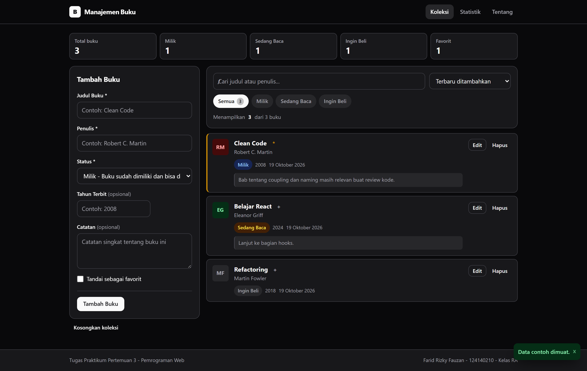
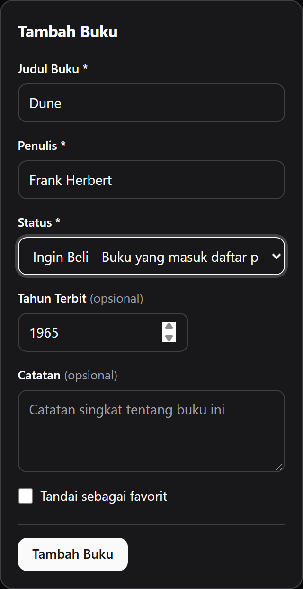
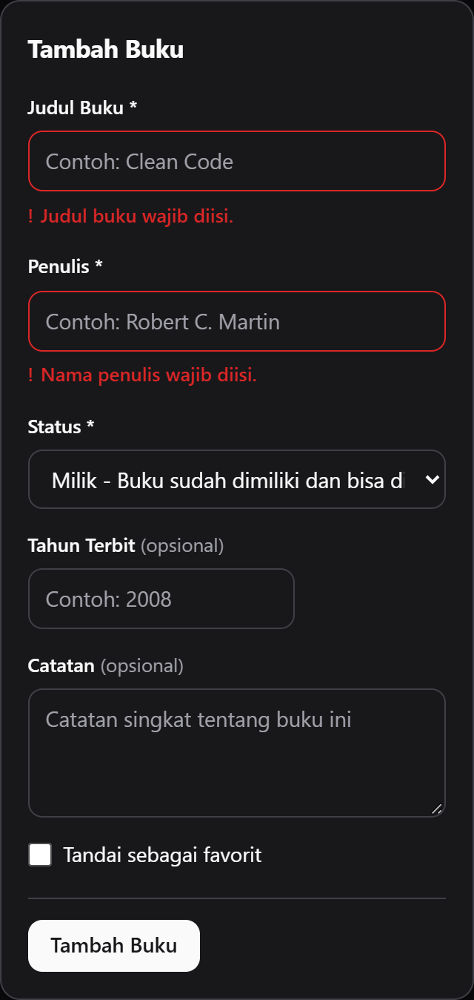
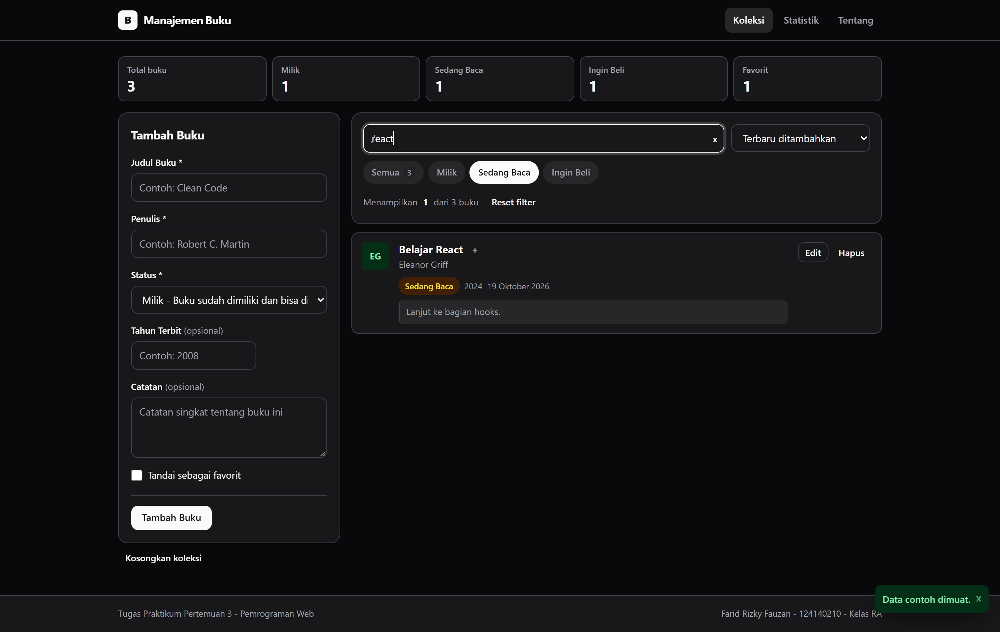
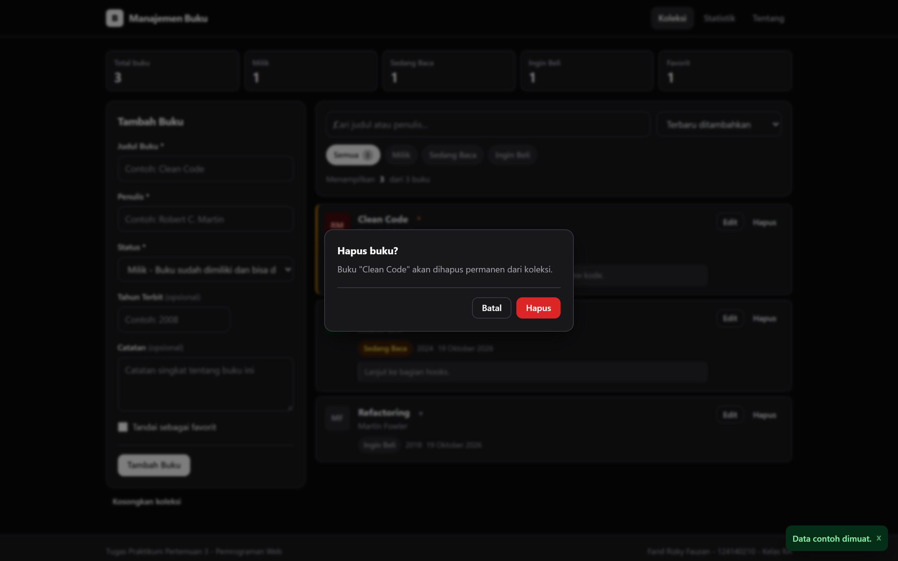
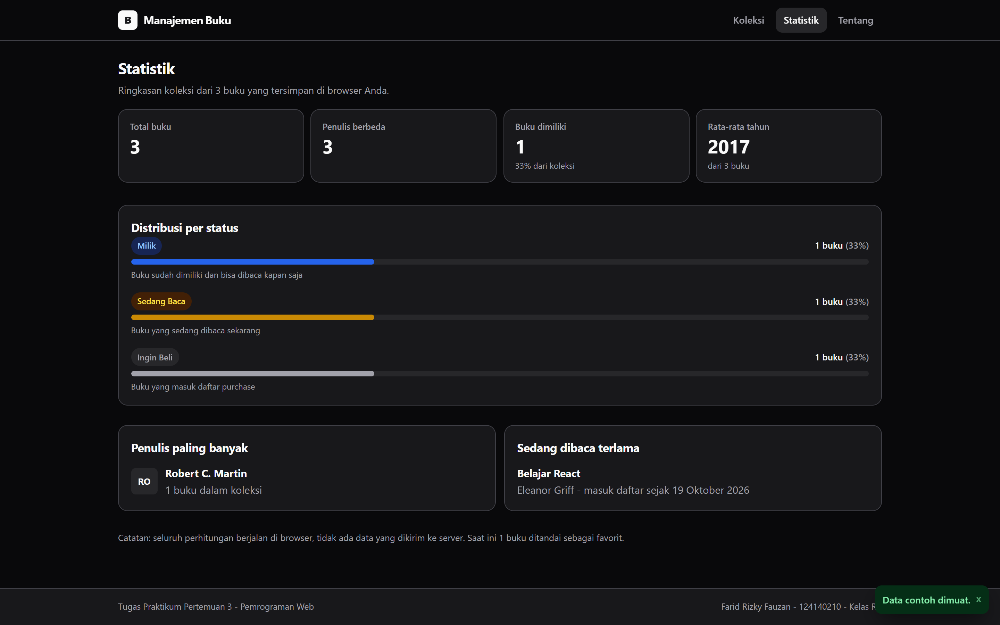
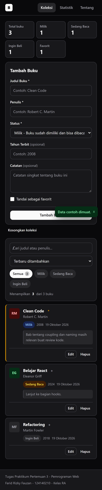
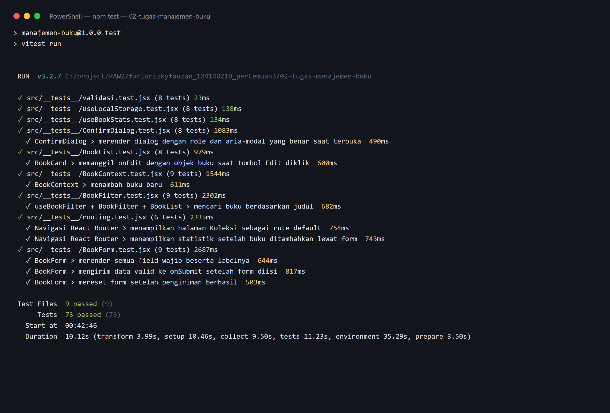

# Tugas Pertemuan 3 - Aplikasi Manajemen Buku

Aplikasi manajemen buku pribadi berbasis React. Buku dicatat, diedit, dihapus,
difilter, dan dicari; seluruh data tersimpan di `localStorage` browser sehingga
tetap ada setelah halaman ditutup.

| | |
|---|---|
| Nama | Farid Rizky Fauzan |
| NIM | 124140210 |
| Kelas | RA |
| Praktikum | Pemrograman Web - Teknik Informatika ITERA |

---

## Daftar Isi

- [Deskripsi](#deskripsi)
- [Cara Menjalankan](#cara-menjalankan)
- [Fitur](#fitur)
- [Teknologi dan Versi](#teknologi-dan-versi)
- [Struktur Folder](#struktur-folder)
- [Penjelasan Fitur React](#penjelasan-fitur-react)
- [Arsitektur dan Alur Data](#arsitektur-dan-alur-data)
- [Validasi dan Error Handling](#validasi-dan-error-handling)
- [Testing](#testing)
- [Kcreenshoot](#kcreenshoot)

---

## Deskripsi

Aplikasi ini menjawab satu masalah nyata: buku yang dimiliki, sedang dibaca,
dan yang ingin dibeli sering tercecer atau terlupa. Daripada memakai satu
daftar, aplikasi ini memisahkan tiga status tersebut sehingga keputusan
"buku mana yang harus saya baca berikutnya" bisa diambil lebih cepat.

Berbeda dari to-do list generik, data di sini berupa buku sastra dan
nonfiksi yang relevan dengan mahasiswa: dari buku pemrograman sampai
sastra klasik. Halaman Statistik membuat aplikasi ini terasa hidup -
ia bukan sekadar form CRUD.

Semua pemrosesan berjalan sepenuhnya di browser. Tidak ada server, tidak ada
akun, dan tidak ada data yang dikirim keluar dari perangkat.

---

## Cara Menjalankan

Prasyarat: **Node.js 18 atau lebih baru** (diuji pada Node 25).

```bash
# 1. Masuk ke folder project
cd faridrizkyfauzan_124140210_pertemuan3/02-tugas-manajemen-buku

# 2. Pasang semua dependensi
npm install

# 3. Jalankan server pengembangan
npm run dev
```

Browser akan terbuka otomatis di `http://localhost:5174`. Hentikan server
dengan menekan `Ctrl + C`.

### Perintah lain

| Perintah | Fungsi |
|---|---|
| `npm run dev` | Server pengembangan dengan hot reload |
| `npm run build` | Build produksi ke folder `dist/` |
| `npm run preview` | Menjalankan hasil build |
| `npm test` | Menjalankan seluruh unit test sekali |
| `npm run test:watch` | Test mode watch, otomatis saat file berubah |

### Menjalankan lewat VS Code

Buka folder ini di VS Code, lalu klik kanan `index.html` > **Open with Live
Server** tidak berlaku untuk project React. Gunakan terminal bawaan VS Code
(`Ctrl + ``) dan jalankan `npm run dev`.

---

## Fitur

### Dasar
- **Tambah buku** - judul, penulis, dan status wajib; tahun terbit, catatan,
  dan penanda favorit bersifat opsional
- **Edit buku** - form yang sama dipakai ulang, hanya mode dan isinya berbeda
- **Hapus buku** - dengan dialog konfirmasi; klik di luar dialog atau tekan
  `Esc` untuk batal
- **Filter status** - semua / milik / sedang baca / ingin beli
- **Pencarian** - mencocokkan judul **dan** penulis, Mengabaikan huruf besar-kecil
- **Pengurutan** - terbaru, judul A-Z, judul Z-A, penulis A-Z, tahun terbaru

### Tambahan
- **Halaman statistik** - total buku, jumlah penulis berbeda, rata-rata tahun
  terbit, progress bar distribusi per status, penulis paling banyak, dan buku
  yang paling lama berstatus "sedang baca"
- **Tandai favorit** - bisa disalakan langsung dari kartu buku
- **Dialog konfirmasi** - dipakai untuk hapus satu buku maupun kosongkan koleksi
- **Notifikasi toast** - muncul sebentar di pojok kanan bawah setiap aksi penting
- **Data contoh** - tombol pengisi saat koleksi masih kosong
- **Tema gelap** - mengikuti preferensi sistem operasi secara otomatis

### Antarmuka
- Layout dua kolom yang berubah menjadi satu kolom di layar sempit
- Semua elemen form terhubung ke `<label>` dan punya umpan balik error yang
  terlihat, bukan hanya warna
- Fokus keyboard selalu terlihat; tombol ikon diberi `aria-label`
- Animasi dimatikan otomatis bila pengguna mengaktifkan pengaturan
  "reduced motion" di sistem operasi

---

## Teknologi dan Versi

| Teknologi | Versi | Peran |
|---|---|---|
| React | 19.1 | Library UI |
| React DOM | 19.1 | Renderer |
| React Router DOM | 7.9 | Navigasi 3 halaman |
| PropTypes | 15.8 | Type checking runtime |
| Vite | 7.3 | Dev server + bundler |
| Vitest | 3.2 | Test runner |
| React Testing Library | 16.3 | Query + render untuk test |
| user-event | 14.6 | Simulasi klik dan ketik |
| jsdom | 27 | Environment DOM untuk test |

Styling ditulis dengan CSS biasa memakai custom property sebagai design token,
bukan framework CSS. Pendekatan ini membuat aplikasi ringan dan seluruh token
warna bisa diubah dari satu tempat.

---

## Struktur Folder

```
02-tugas-manajemen-buku/
├── index.html                  # Shell HTML, hanya berisi <div id="root">
├── package.json
├── vite.config.js              # Konfigurasi Vite + Vitest
├── docs/
│   ├── screenshots/            # 8 tangkapan layar untuk laporan
│   └── README-screenshots.txt  # Panduan nama file tiap screenshot
└── src/
    ├── main.jsx                # Entry point: createRoot + StrictMode
    ├── App.jsx                 # HashRouter, routes, provider global
    ├── App.css
    ├── setupTests.js           # Setup environment test
    │
    ├── context/
    │   └── BookContext.jsx     # Global state (Context API)
    │
    ├── hooks/
    │   ├── useLocalStorage.js  # Custom hook 1 - persistensi
    │   ├── useBookStats.js     # Custom hook 2 - agregasi statistik
    │   ├── useBookFilter.js    # Custom hook 3 - pencarian + sorting
    │   └── useToast.js         # Custom hook 4 - notifikasi
    │
    ├── components/
    │   ├── Navbar/             # Navigasi (NavLink + penanda aktif)
    │   ├── BookForm/           # Form controlled + validasi
    │   ├── BookFilter/         # Panel cari, filter, sorting
    │   ├── BookList/           # Daftar hasil filter
    │   ├── BookCard/           # Satu kartu buku
    │   ├── ConfirmDialog/      # Dialog konfirmasi (Esc + focus trap)
    │   ├── EmptyState/         # Placeholder saat data kosong
    │   └── Toast/              # Notifikasi sementara
    │
    ├── pages/
    │   ├── Home/               # Koleksi: form + filter + daftar
    │   ├── Stats/              # Statistik koleksi
    │   └── About/              # Identitas + penjelasan fitur
    │
    ├── utils/
    │   ├── constants.js        # Status, opsi sort, identitas, data contoh
    │   ├── validasi.js         # Fungsi validasi form (murni)
    │   └── format.js           # Helper format tampilan
    │
    ├── styles/
    │   └── global.css          # Design token + primitif (.btn, .input, .badge)
    │
    └── __tests__/              # 73 unit test
        ├── validasi.test.jsx
        ├── useLocalStorage.test.jsx
        ├── useBookStats.test.jsx
        ├── BookForm.test.jsx
        ├── BookList.test.jsx
        ├── BookFilter.test.jsx
        ├── BookContext.test.jsx
        ├── ConfirmDialog.test.jsx
        └── routing.test.jsx
```

Setiap komponen punya folder sendiri berisi `.jsx` dan `.css`. Pemisahan ini
membuat mudah mencari file saat codebase bertambah besar.

---

## Penjelasan Fitur React

### 1. Functional Components & Hooks

Seluruh komponen adalah function - tidak ada satu pun `class Component` di
project ini. Perilaku ditambahkan lewat hooks:

| Hook | Dipakai di | Untuk |
|---|---|---|
| `useState` | hampir semua komponen | menyimpan nilai yang berubah |
| `useEffect` | `BookContext`, `ConfirmDialog`, `useLocalStorage` | efek samping |
| `useMemo` | `BookContext`, `useBookStats`, `useBookFilter` | optimasi perhitungan |
| `useCallback` | `BookContext`, `useLocalStorage` | menjaga referensi action stabil |
| `useContext` | semua halaman dan komponen | membaca state global |
| `useId` | `BookForm` | membuat `id` unik untuk label form |
| `useRef` | `ConfirmDialog`, `useLocalStorage` | menyimpan nilai di luar render |

### 2. Context API - State Management Global

Tanpa context, data `books` harus dioper sebagai props dari `App` ->
`Navbar` -> `Home` -> `BookList` -> `BookCard`, meskipun `Navbar` tidak
perlu data itu sama sekali. Itulah yang disebut **props drilling**.

`BookContext` memutus rantai tersebut. `BookProvider` menyimpan seluruh
koleksi, dan setiap komponen bisa langsung membacanya:

```jsx
function BookCard({ book }) {
  const { toggleFavorit } = useBooks();
  // ...
}
```

Dua optimasi penting di provider:

```jsx
// 1. Semua action dibungkus useCallback -> referensinya tidak berubah
const tambahBuku = useCallback((data) => { ... }, [setBooks]);

// 2. Objek context dibungkus useMemo -> consumer tidak dirender ulang
//    tanpa alasan. Tanpa ini, setiap ketikan di form akan me-render ulang
//    seluruh halaman.
const value = useMemo(() => ({ books, tambahBuku, ... }), [books, ...]);
```

Hook `useBooks()` juga melempar error bila dipakai di luar provider, supaya
bug ini terdeteksi saat development, bukan muncul diam-diam sebagai
`undefined`.

### 3. Empat Custom Hook

Tugas hanya mewajibkan dua; project ini membuat empat.

| Hook | Masalah yang diselesaikan |
|---|---|
| `useLocalStorage` | Menyinkronkan state ke `localStorage` tanpa menulis ulang `useState` + `useEffect` di setiap tempat |
| `useBookStats` | Menghitung 9 angka turunan dengan `useMemo` agar tidak dihitung ulang tiap render |
| `useBookFilter` | Menyatukan pencarian, filter, dan sorting dalam satu tempat |
| `useToast` | Mengelola antrean notifikasi yang tampil lalu hilang sendiri |

Contoh `useLocalStorage` dalam bentuk paling sederhana:

```jsx
const [nilai, setNilai] = useState(() => baca(key, nilaiAwal));

useEffect(() => {
  window.localStorage.setItem(key, JSON.stringify(nilai));
}, [key, nilai]);
```

Hook ini menangani tiga hal yang sering terlewat:

1. **JSON rusak** - `JSON.parse` dibungkus `try/catch`, jadi data rusak tidak
   membuat aplikasi blank
2. **Nilai falsy** - tidak memakai `|| nilaiAwal` karena itu akan menimpa nilai
   `0`, `false`, dan `""` yang sah
3. **Kuota penuh / mode privat** - ada pemeriksaan ketersediaan storage dan
   fallback ke memory

### 4. React Router

Tiga halaman dikemas dengan `HashRouter`:

```jsx
<HashRouter>
  <Routes>
    <Route path="/" element={<Home notif={notif} />} />
    <Route path="/statistik" element={<Stats />} />
    <Route path="/tentang" element={<About />} />
    <Route path="*" element={<TidakDitemukan />} />
  </Routes>
</HashRouter>
```

**Mengapa `HashRouter`, bukan `BrowserRouter`?** Keduanya API-nya identik,
tetapi `HashRouter` menaruh rute setelah tanda pagar (`/#/statistik`) sehingga
tidak butuh konfigurasi rewrite di sisi server. Ini membuat aplikasi tetap
bisa dibuka dari hosting statis seperti GitHub Pages atau langsung dari
folder hasil build.

Penanda tautan aktif diberikan React sendiri lewat `NavLink` dengan
`className` berbentuk fungsi:

```jsx
<NavLink
  to={t.ke}
  className={({ isActive }) => `navbar-tautan${isActive ? ' aktif' : ''}`}
>
```

### 5. Controlled Components

Setiap input punya `value` yang berasal dari state dan `onChange` yang
memanggil setter. Tidak ada satu pun input yang uncontrolled di project ini.

```jsx
const [values, setValues] = useState({ ...FORM_KOSONG, ...nilaiAwal });

const ubah = (field) => (e) => {
  const nilai = e.target.value;
  setValues((v) => ({ ...v, [field]: nilai }));
};
```

Konsekuensinya, reset form setelah submit cukup satu baris, dan validasi
menjadi deterministik:

```jsx
onSubmit(nilai);
setValues({ ...FORM_KOSONG });
setErrors({});
setTouched({});
```

### 6. Conditional Rendering & Lists

Tiga kondisi di `BookList` dibedakan agar pesan yang muncul benar-benar
menjelaskan masalahnya:

```jsx
if (total === 0)        return <EmptyState judul="Koleksi masih kosong" ... />;
if (books.length === 0) return <EmptyState judul="Tidak ada buku yang cocok" ... />;
```

Setiap buku dirender dengan `key` berupa `book.id`, bukan indeks array:

```jsx
{books.map((book) => (
  <BookCard key={book.id} book={book} ... />
))}
```

Kalau memakai indeks sebagai key, menghapus buku di tengah daftar membuat
React salah mencocokkan komponen lama dengan data baru - gejalanya input
di dalam kartu kehilangan fokus saat urutan berubah.

### 7. PropTypes

Semua komponen yang menerima props punya `propTypes`, termasuk validator
bersarang untuk bentuk data buku:

```jsx
BookCard.propTypes = {
  book: PropTypes.shape({
    id: PropTypes.string.isRequired,
    judul: PropTypes.string.isRequired,
    status: PropTypes.string.isRequired,
    tahun: PropTypes.number,
    favorit: PropTypes.bool,
  }).isRequired,
  onEdit: PropTypes.func.isRequired,
  onHapus: PropTypes.func.isRequired,
  onToggleFavorit: PropTypes.func.isRequired,
};
```

Nilai default ditulis sebagai **default parameter** di tanda tangan fungsi,
bukan `Component.defaultProps` - yang terakhir sudah dihapus mulai React 19.

### 8. useEffect - Contoh Dua Kegunaan Berbeda

Mengatur judul tab di `BookContext`:

```jsx
useEffect(() => {
  document.title = `Manajemen Buku (${books.length}) - PAW ITERA`;
}, [books.length]);
```

Mengelola listener dan fokus keyboard di `ConfirmDialog`:

```jsx
useEffect(() => {
  if (!terbuka) return undefined;

  const onKeyDown = (e) => { if (e.key === 'Escape') onBatal(); };
  document.addEventListener('keydown', onKeyDown);
  refTombol.current?.focus();

  const overflowAwal = document.body.style.overflow;
  document.body.style.overflow = 'hidden';

  // Cleanup wajib: tanpa ini, setiap buka dialog akan menumpuk listener.
  return () => {
    document.removeEventListener('keydown', onKeyDown);
    document.body.style.overflow = overflowAwal;
  };
}, [terbuka, onBatal]);
```

---

## Arsitektur dan Alur Data

```
        Aksi pengguna
              |
              v
   +------------------------+
   |  Halaman (Home/Stats)  |   useState lokal: form, filter, dialog
   +------------------------+
              |
              v
   +------------------------+
   |   BookProvider         |   sumber kebenaran tunggal
   |   (Context API)        |
   +------------------------+
        |             ^
        v             |
   +-------------+  |   auto-sync tiap perubahan
   | useLocalStorage|  |
   +-------------+  |
        |             |
        v             |
   +------------------------+
   |    localStorage       |
   +------------------------+
```

Alur satu penambahan buku:

1. User mengisi form - nilai disimpan sebagai **state lokal** `BookForm`
2. Submit memanggil `validasiBuku(values)`, fungsi murni di `utils/validasi.js`
3. Validasi gagal -> `setErrors`, field ditandai `touched`, pesan tampil
4. Validasi sukses -> `Home.handleSubmit` memanggil `tambahBuku(nilai)`
5. `BookContext` membuat objek buku baru dengan `id` dan `timestamp`
6. Array di-update secara immutable (`[bukuBaru, ...prev]`)
7. `useLocalStorage` menulis array baru ke `localStorage` lewat `useEffect`
8. Semua komponen yang memakai context ikut dirender ulang

### Normalisasi data

Data dari `localStorage` tidak selalu dipercaya - bisa berasal dari versi
aplikasi sebelumnya, atau diedit manual dari DevTools. Karena itu setiap buku
dinormalisasi sebelum dipakai:

```jsx
const normalisasiBuku = (buku) => ({
  id: buku.id ?? buatId(),
  status: Object.values(STATUS).includes(buku.status) ? buku.status : STATUS.MILIK,
  tahun: Number.isInteger(buku.tahun) ? buku.tahun : null,
  favorit: Boolean(buku.favorit),
  // ...
});
```

Tanpa ini, satu buku dengan `status: "entah"` akan membuat seluruh halaman
Statistik gagal dihitung.

---

## Validasi dan Error Handling

### Validasi form

Fungsi `validasiBuku()` di `utils/validasi.js` bersifat murni - tidak menyentuh
state maupun DOM, sehingga bisa diuji tanpa merender apa pun.

| Field | Aturan |
|---|---|
| Judul | Wajib, 2-120 karakter |
| Penulis | Wajib, 2-120 karakter |
| Status | Wajib, salah satu dari `milik` / `baca` / `beli` |
| Tahun | Opsional; kalau diisi harus bilangan bulat 1450 - tahun depan |
| Catatan | Opsional, maksimal 500 karakter |

Fungsi ini mengembalikan **semua** error sekaligus, bukan berhenti di error
pertama - pengguna tidak perlu mengirim form berulang kali.

### Pola `touched`

Pesan error tidak langsung merah ketika form baru dibuka. Field baru ditandai
bermasalah setelah pengguna menyentuh lalu mengosongkannya. Poin merah muncul
karena `aria-invalid="true"` beserta pesan yang terhubung lewat
`aria-describedby`:

```jsx
const err = (field) => (touched[field] ? errors[field] : undefined);
```

### Penanganan kondisi tidaknormal

| Kondisi | Penanganan |
|---|---|
| `localStorage` berisi JSON rusak | `try/catch`, kembali ke nilai awal |
| `localStorage` berisi nilai non-array | Dikenali dan diganti array kosong |
| Buku tanpa `id` | `id` baru dibuat otomatis |
| `status` tak dikenal | Jatuh ke default `milik` |
| Kuota localStorage penuh | Fallback ke memory, aplikasi tetap jalan |
| Browser memblokir penyimpanan | Deteksi di awal, mode non-persisten |
| Filter tidak menemukan hasil | Pesan "tidak ada yang cocok" + tombol reset, bukan layar kosong |

---

## Testing

Tugas mewajibkan minimal 5 test. Project ini memiliki **73 test** yang
mencakup seluruh lapisan aplikasi.

```bash
npm test
```

Hasil eksekusi tersimpan sebagai tangkapan layar di
[`docs/screenshots/08-laporan-testing.png`](docs/screenshots/08-laporan-testing.png)
- `Test Files 9 passed (9)` dan `Tests 73 passed (73)`, 0 gagal.

### Ringkasan

| File test | Jumlah test | Cakupan |
|---|---:|---|
| `validasi.test.jsx` | 8 | Fungsi validasi form (murni) |
| `useLocalStorage.test.jsx` | 8 | Persistensi, JSON rusak, nilai falsy, updater |
| `useBookStats.test.jsx` | 8 | Agregasi statistik termasuk kasus koleksi kosong |
| `BookForm.test.jsx` | 9 | Validasi, submit, reset, mode edit |
| `BookList.test.jsx` | 8 | Rendering kartu dan callback-nya |
| `BookFilter.test.jsx` | 9 | Pencarian, filter status, sorting |
| `BookContext.test.jsx` | 9 | CRUD melalui provider |
| `ConfirmDialog.test.jsx` | 8 | Esc, backdrop, fokus tombol |
| `routing.test.jsx` | 6 | Perpindahan halaman dan penanda aktif |
| **Total** | **73** | |

### Prinsip yang dipakai

Test ditulis dari sudut pandang pengguna, bukan dari struktur internal
komponen:

```jsx
// Benar - mencocokkan apa yang dilihat pengguna
await user.type(screen.getByLabelText(/judul buku/i), 'Dune');
await user.click(screen.getByRole('button', { name: /tambah buku/i }));
expect(screen.getByRole('button', { name: /hapus dune/i })).toBeInTheDocument();

// Hindari - menyentuh state internal, rapuh dan sulit dirawat
// expect(component.state.form.judul).toBe('Dune');
```

Selector memakai atribut aksesibilitas (`getByRole`, `getByLabelText`)
sehingga sekaligus memverifikasi bahwa label dan tombol ikon sudah
diberi penjelasan yang benar untuk pembaca layar.

### Konfigurasi test

```js
// vite.config.js
test: {
  globals: true,
  environment: 'jsdom',
  setupFiles: './src/setupTests.js',
  restoreMocks: true,
}
```

### Catatan kompatibilitas Node

`setupTests.js` memasang implementasi `localStorage` in-memory. Node 22+
menyediakan global `localStorage` bawaan yang, tanpa flag
`--localstorage-file`, tidak memiliki metode `clear()` dan menggantikan
implementasi jsdom - gejalanya seluruh test gagal dengan
`window.localStorage.clear is not a function`. Shim ini membuat test berjalan
konsisten di semua versi Node.

---

## Kcreenshoot

Folder `docs/screenshots/` berisi tangkapan layar untuk laporan.

### Tampilan utama

| Koleksi utama | Tambah buku | Validasi error |
|---|---|---|
|  |  |  |

### Fitur dan navigasi

| Filter dan pencarian | Dialog konfirmasi hapus | Halaman statistik |
|---|---|---|
|  |  |  |

### Responsif dan laporan testing

| Tampilan mobile (390 px) | Laporan `npm test` |
|---|---|
|  |  |

---

## Lisensi

MIT - lihat file [`LICENSE`](LICENSE).