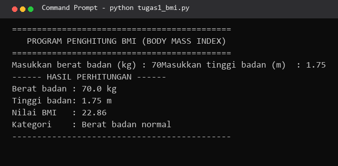
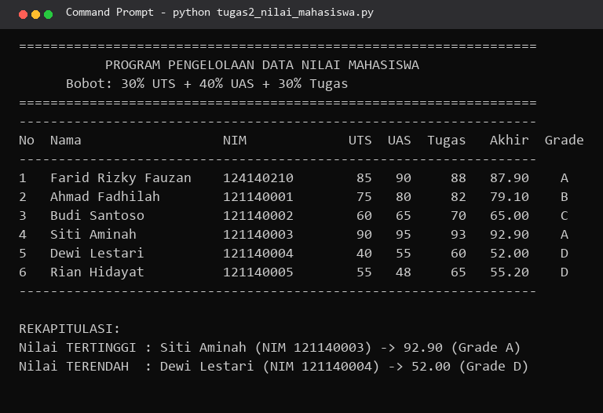
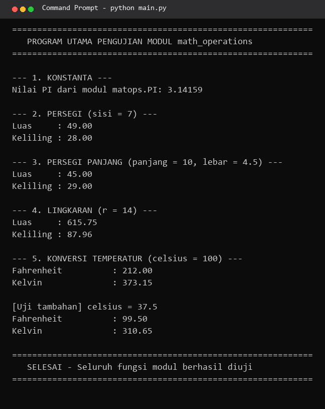

# Pertemuan 4 - Python Dasar

Topik pertemuan ini adalah **Python Dasar** — fondasi backend sebelum masuk ke
Python OOP (Pertemuan 5) dan Pyramid Framework (Pertemuan 6). Pengumpulan ini
berisi dua bagian, mengikuti pola Pertemuan 1–3: materi praktikum (6 berkas
topik + 6 latihan mandiri) dan tugas (3 program Python).

| | |
|---|---|
| Nama | Farid Rizky Fauzan |
| NIM | 124140210 |
| Kelas | RA |
| Praktikum | Pemrograman Web - Teknik Informatika ITERA |

---

## Struktur Folder

```
faridrizkyfauzan_124140210_pertemuan4/
├── README.md
├── LICENSE
├── .gitignore
│
├── tugas1_bmi.py                  # Tugas 1 (30%) - Penghitung BMI
├── tugas2_nilai_mahasiswa.py      # Tugas 2 (40%) - Pengelolaan Nilai Mahasiswa
├── math_operations.py             # Tugas 3 (30%) - Modul matematika
├── main.py                        # Tugas 3 (30%) - Program utama pengguna modul
├── screenshots/                   # Bukti eksekusi terminal
│
└── praktikum/                     # Materi praktikum (mengikuti modul)
    ├── 01_pengenalan.py           # print(), sep, end, escape character
    ├── 02_variabel.py             # tipe data, type(), f-string, casting, input()
    ├── 03_kendali.py              # if/elif/else, ternary, for, while, break/continue
    ├── 04_fungsi.py               # def, default arg, *args/**kwargs, lambda
    ├── 05_struktur_data.py        # list, comprehension, tuple, dict, set
    ├── kalkulator_lib.py          # modul kustom (tambah/kurang/kali/bagi)
    ├── 06_modul_app.py            # standard library + import modul kustom
    └── latihan/                   # Latihan mandiri modul
        ├── latihan1_identitas.py  # kartu identitas, sep=' | ', bingkai #
        ├── latihan2_suhu.py       # konversi Celcius -> Fahrenheit & Kelvin
        ├── latihan3_tebak.py      # game tebak angka (while + break)
        ├── latihan4_validasi.py   # validator password (min 8 karakter + angka)
        ├── latihan5_kontak.py     # katalog kontak (dict + .get() + menu loop)
        ├── password_gen.py        # modul generator password acak
        └── main.py                # program pengguna modul password_gen
```

---

## Cara Menjalankan

Pastikan **Python 3.8+** sudah terpasang (`python --version`), lalu jalankan
dari dalam folder ini:

```bash
# ===== TUGAS =====
python tugas1_bmi.py               # input: berat (kg) & tinggi (m) -> BMI + kategori
python tugas2_nilai_mahasiswa.py   # langsung tampil (data di dalam kode)
python main.py                     # uji seluruh fungsi modul math_operations
python math_operations.py          # (opsional) uji modul mandiri

# ===== PRAKTIKUM =====
python praktikum/01_pengenalan.py  # sampai 06: tanpa input, langsung jalan
python praktikum/02_variabel.py    # meminta input nama & jumlah item

# ===== LATIHAN MANDIRI =====
python praktikum/latihan/latihan1_identitas.py
python praktikum/latihan/latihan2_suhu.py      # input suhu Celcius
python praktikum/latihan/latihan3_tebak.py     # main game tebak angka
python praktikum/latihan/latihan4_validasi.py
python praktikum/latihan/latihan5_kontak.py    # menu interaktif 1-4
python praktikum/latihan/main.py               # uji modul password_gen
```

> Catatan: berkas yang menerima `input()` sebaiknya dijalankan langsung di
> terminal VS Code agar prompt terlihat jelas.

---

## Ringkasan Tugas

### Tugas 1 — Program Penghitung BMI (30%) — `tugas1_bmi.py`

- Input berat (kg) dan tinggi (m) melalui `input()`, divalidasi dengan
  `try/except ValueError` agar program tidak crash saat input bukan angka.
- Rumus `BMI = berat / (tinggi * tinggi)`, hasil diformat 2 desimal (f-string).
- Kategori via `if-elif-else`: kurang (< 18.5), normal (18.5–24.9),
  berlebih (25–29.9), obesitas (≥ 30).
- Fungsi: `hitung_bmi()`, `tentukan_kategori()`, `baca_angka_positif()`,
  `main()` — semuanya ber-docstring.

### Tugas 2 — Pengelolaan Data Nilai Mahasiswa (40%) — `tugas2_nilai_mahasiswa.py`

- **List berisi 6 dictionary** mahasiswa (kunci: `nama`, `nim`, `nilai_uts`,
  `nilai_uas`, `nilai_tugas`) — melebihi syarat minimal 5.
- Nilai akhir = `(30% × UTS) + (40% × UAS) + (30% × Tugas)` dengan konstanta
  bobot `BOBOT_UTS/BOBOT_UAS/BOBOT_TUGAS` di atas berkas.
- Grade A–E sesuai kriteria modul (A ≥ 80, B 70–79, C 60–69, D 50–59, E < 50).
- Tabel rapi memakai perataan f-string (lebar kolom tetap): No, Nama, NIM,
  UTS, UAS, Tugas, Akhir, Grade.
- Pencarian tertinggi/terendah dengan list comprehension + `max()`/`min()`,
  lalu direkap beserta grade-nya.

### Tugas 3 — Modul Matematika (30%) — `math_operations.py` + `main.py`

**Modul `math_operations.py`:**

- 3 bentuk geometri × 2 fungsi (luas & keliling): persegi, persegi panjang,
  lingkaran — total 6 fungsi geometri.
- 2 fungsi konversi suhu: `celsius_ke_fahrenheit()` (F = C × 9/5 + 32) dan
  `celsius_ke_kelvin()` (K = C + 273.15).
- 1 konstanta `PI = 3.14159`.
- Dilengkapi blok `if __name__ == "__main__":` untuk uji modul mandiri —
  blok ini tidak ikut tereksekusi ketika modul di-import.

**Program utama `main.py`:** menerapkan **dua cara impor berbeda** sesuai
ketentuan soal:

1. `import math_operations as matops` → memakai seluruh fungsi geometri
   dan konstanta `PI` lewat alias.
2. `from math_operations import celsius_ke_fahrenheit, celsius_ke_kelvin`
   → memanggil fungsi konversi langsung tanpa awalan modul.

---

## Ringkasan Praktikum

| # | Berkas | Materi |
|---|---|---|
| 1 | `01_pengenalan.py` | `print()`, beberapa argumen, `sep`, `end`, escape `\n` dan `\t` |
| 2 | `02_variabel.py` | tipe data + `type()`, f-string `:,.2f`, indexing/slicing string, casting, `input()` |
| 3 | `03_kendali.py` | `if-elif-else`, ternary, `range()`, `enumerate()`, `while` + `break` + `else`, nested loop |
| 4 | `04_fungsi.py` | `def`, docstring, default parameter, multiple return (tuple unpacking), `*args`/`**kwargs`, lambda |
| 5 | `05_struktur_data.py` | list (append/insert/remove/pop), list comprehension, tuple, dict + `.get()`, set union/intersection/difference |
| 6 | `06_modul_app.py` | `math.hypot`, `random`, `datetime`, impor modul kustom `kalkulator_lib` |

Latihan mandiri di folder `praktikum/latihan/` mengerjakan keenam latihan
yang ada di modul (identitas, konversi suhu, tebak angka, validator password,
katalog kontak, dan generator password).

---

## Tangkapan Layar

Bukti hasil eksekusi program di terminal:

| Tugas 1 — BMI | Tugas 2 — Tabel nilai | Tugas 3 — Modul |
|---|---|---|
|  |  |  |

> Tugas 1 dijalankan dengan input contoh berat 70 kg dan tinggi 1.75 m
> (BMI 22.86 — Berat badan normal).
