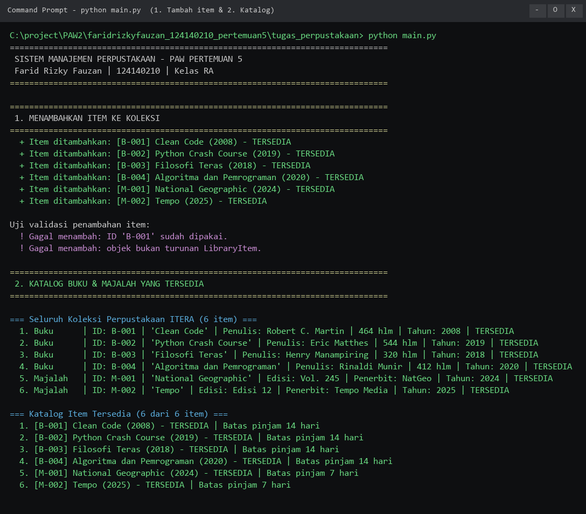
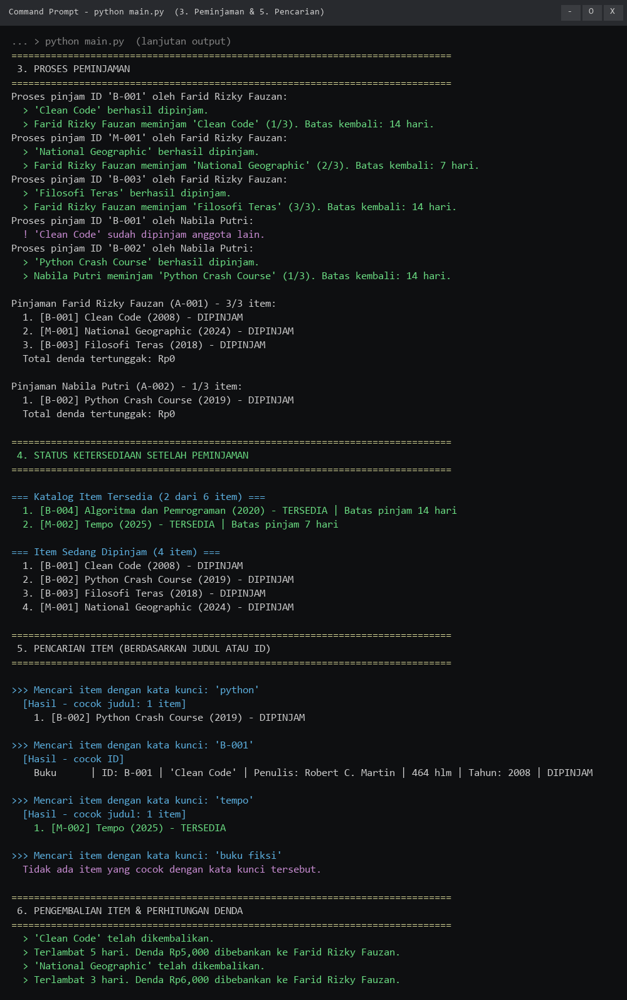
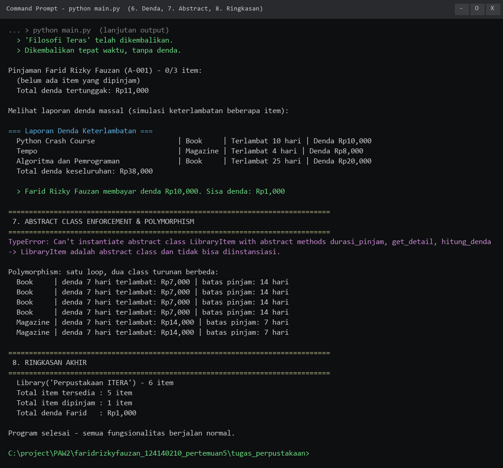

# Pertemuan 5 - Python OOP

Topik pertemuan ini adalah **Python Object-Oriented Programming (OOP)** — kelanjutan
langsung dari Python Dasar (Pertemuan 4) dan fondasi sebelum masuk ke Pyramid
Framework (Pertemuan 6). Pengumpulan ini berisi dua bagian, mengikuti pola
Pertemuan 1–4: materi praktikum (7 berkas hands-on) dan tugas
(**Sistem Manajemen Perpustakaan**).

| | |
|---|---|
| Nama | Farid Rizky Fauzan |
| NIM | 124140210 |
| Kelas | RA |
| Praktikum | Pemrograman Web - Teknik Informatika ITERA |

---

## Struktur Folder

```
faridrizkyfauzan_124140210_pertemuan5/
├── README.md
├── .gitignore
│
├── latihan/                        # Materi praktikum (hands-on modul)
│   ├── 01_everything_is_object.py  # type(), id(), __class__, dunder
│   ├── 01_procedural_vs_oop.py     # perbandingan prosedural vs OOP
│   ├── 02_class_object.py          # class, __init__, self, atribut, __str__/__repr__
│   ├── 03_inheritance.py           # pewarisan, super(), override, MRO, multiple inheritance
│   ├── 04_encapsulation.py         # public/protected/private, @property, name mangling
│   ├── 05_polymorphism.py          # override, duck typing, operator overloading
│   └── 06_abstract_class.py        # ABC, @abstractmethod, enforcement, interface
│
├── tugas_perpustakaan/             # TUGAS: Sistem Manajemen Perpustakaan
│   ├── library_item.py             # Abstract class LibraryItem + Book + Magazine
│   ├── member.py                   # Class Member (anggota & pinjaman)
│   ├── library.py                  # Class Library (koleksi, tambah, cari)
│   └── main.py                     # Program utama demo (jalankan ini)
│
└── screenshots/                    # Bukti eksekusi program
    ├── 01-tambah-dan-katalog.png
    ├── 02-peminjaman-dan-pencarian.png
    └── 03-denda-abstract-ringkasan.png
```

---

## Cara Menjalankan

Pastikan **Python 3.8+** sudah terpasang (`python --version`), lalu jalankan
dari dalam folder ini:

```bash
# ===== TUGAS: SISTEM MANAJEMEN PERPUSTAKAAN =====
cd tugas_perpustakaan
python main.py                     # demo lengkap: tambah, katalog, cari, pinjam, denda

# ===== LATIHAN PRAKTIKUM =====
python latihan/01_everything_is_object.py
python latihan/01_procedural_vs_oop.py
python latihan/02_class_object.py
python latihan/03_inheritance.py
python latihan/04_encapsulation.py
python latihan/05_polymorphism.py
python latihan/06_abstract_class.py
```

> Semua berkas bersifat non-interaktif (data sudah ada di dalam kode), jadi
> bisa dijalankan langsung tanpa input tambahan.

---

## Konsep OOP yang Diterapkan

Ringkasan empat pilar OOP (plus konsep pendukung) beserta implementasinya
di tugas perpustakaan:

### 1. Abstraction & Inheritance (30%)

- `LibraryItem` adalah **abstract class** turunan `ABC` (`from abc import ABC,
  abstractmethod`) yang mendefinisikan kontrak: `get_detail()`,
  `hitung_denda()`, dan `durasi_pinjam()` wajib diimplementasikan.
- Instansiasi langsung `LibraryItem(...)` ditolak Python dengan
  `TypeError: Can't instantiate abstract class LibraryItem with abstract
  methods durasi_pinjam, get_detail, hitung_denda`.
- Dua subclass konkret mewarisi `LibraryItem` lewat `super().__init__(...)`:
  - `Book` — durasi pinjam 14 hari, denda Rp1.000/hari (maks Rp20.000).
  - `Magazine` — durasi pinjam 7 hari, denda Rp2.000/hari (maks Rp20.000).
- Method konkret `pinjam()`, `kembalikan()`, serta `__str__`/`__repr__`
  diwarisi otomatis, sehingga tidak perlu ditulis ulang di tiap subclass.

### 2. Encapsulation (25%)

- Atribut **private** dengan name mangling:
  - `Library.__koleksi` → hanya bisa diubah lewat `tambah_item()`/`hapus_item()`.
  - `Member.__pinjaman`, `Member.__total_denda` → hanya lewat `pinjam_item()`,
    `kembalikan_item()`, `bayar_denda()`.
  - `LibraryItem.__dipinjam` → status hanya bisa diubah oleh `pinjam()`/`kembalikan()`.
- Atribut **protected** (`_judul`, `_item_id`, `_nama`) untuk data yang
  perlu diakses subclass.
- Properti read-only via `@property`: `item_id`, `judul`, `is_dipinjam`,
  `koleksi`, `pinjaman`, `total_denda`, `jumlah_koleksi`.
- Validasi state: ID duplikat ditolak, objek non-`LibraryItem` ditolak,
  item yang sedang dipinjam tidak bisa dihapus, dan kuota pinjam anggota
  dibatasi `BATAS_PINJAM = 3`.

### 3. Polymorphism (20%)

- **Method overriding**: `get_detail()`, `hitung_denda()`, dan
  `durasi_pinjam()` punya perilaku berbeda di `Book` dan `Magazine`, namun
  dipanggil lewat satu antarmuka yang sama.
- Satu loop memproses campuran `Book` dan `Magazine` tanpa `isinstance`:
  ```python
  for item in perpustakaan.koleksi:
      print(type(item).__name__, item.hitung_denda(7), item.durasi_pinjam())
  ```
- Dukungan **operator overloading** (`Library.__len__`, `Library.__str__`),
  serta `Library.cari()` yang menangani dua bentuk pencarian berbeda
  (ID eksak & judul parsial) dalam satu method.

### 4. Functionality (15%)

| Fitur | Method |
|---|---|
| Tambah item | `Library.tambah_item()` (+ validasi ID unik & tipe objek) |
| Hapus item | `Library.hapus_item()` |
| Tampilkan katalog tersedia | `Library.tampilkan_tersedia()` |
| Tampilkan item dipinjam | `Library.tampilkan_dipinjam()` |
| Tampilkan semua koleksi | `Library.tampilkan_semua()` |
| Cari berdasarkan judul | `Library.cari_item()` |
| Cari berdasarkan ID | `Library.cari_by_id()` |
| Cari cerdas (ID atau judul) | `Library.cari()` |
| Pinjam & kembalikan | `Member.pinjam_item()`, `Member.kembalikan_item()` |
| Denda & pelunasan | `LibraryItem.hitung_denda()`, `Member.bayar_denda()` |
| Laporan denda massal | `Library.laporan_denda()` |

---

## Ringkasan Latihan Praktikum

| # | Berkas | Materi |
|---|---|---|
| 1 | `01_everything_is_object.py` | `type()`, `__class__`, `id()`, dunder `__len__`/`__doc__` — membuktikan semua tipe adalah objek |
| 2 | `01_procedural_vs_oop.py` | Data & fungsi terpisah (prosedural) vs state & perilaku menyatu (OOP) + rancangan entitas kasir |
| 3 | `02_class_object.py` | Atribut class vs instance, `self`, `__init__`, `update_ipk()` bervalidasi, `__str__`/`__repr__` |
| 4 | `03_inheritance.py` | `super()`, override `info()`/`bergerak()`, `isinstance()`/`issubclass()`, multiple inheritance + MRO, subclass `Truk` |
| 5 | `04_encapsulation.py` | Public/protected/private, getter-setter `@property`, `AttributeError` name mangling, class `Karyawan` (gaji minimal Rp3.200.000) |
| 6 | `05_polymorphism.py` | `TransferBank`/`EWallet`/`VirtualAccount`, duck typing `CryptoPayment`, operator overloading `Dompet`, broadcast notifikasi |
| 7 | `06_abstract_class.py` | `Shape` ABC (+ `PersegiPanjang`, `Lingkaran`, `Segitiga`), interface `DatabaseConnector`, `TypeError` enforcement, `FileStorage` |

Latihan mandiri yang ada di modul (entitas kasir, `Truk`, `Karyawan`,
notifikasi multi-kanal, dan storage) dikerjakan langsung di dalam berkas
topik masing-masing.

---

## Tangkapan Layar

Bukti hasil eksekusi `python main.py` pada folder `tugas_perpustakaan/`:

### 1. Menambahkan item + katalog tersedia

Menunjukkan penambahan 6 item (4 buku + 2 majalah), penolakan ID duplikat,
penolakan objek non-`LibraryItem`, serta katalog yang hanya menampilkan
item berstatus `TERSEDIA`.



### 2. Peminjaman + pencarian

Menunjukkan proses peminjaman (termasuk penolakan item yang sudah dipinjam
anggota lain dan batas kuota 3 item), perubahan status ketersediaan, serta
pencarian berdasarkan **judul** (`python`, `tempo`), berdasarkan **ID**
(`B-001`), dan kata kunci yang tidak ditemukan.



### 3. Denda, abstract class, dan ringkasan

Menunjukkan perhitungan denda keterlambatan (Rp1.000/hari untuk buku,
Rp2.000/hari untuk majalah, dengan batas maksimal), pelunasan denda,
`TypeError` saat instansiasi `LibraryItem` (bukti abstract class bekerja),
polymorphism dalam satu loop, dan ringkasan kondisi akhir perpustakaan.



---

## Catatan Implementasi

- Seluruh berkas memakai header identitas (Berkas/Topik/Nama/NIM/Kelas) dan
  docstring pada setiap class serta method, konsisten dengan Pertemuan 1–4.
- Setiap berkas latihan dibungkus `if __name__ == "__main__":` agar aman
  bila di-import.
- `main.py` mengimpor `library_item`, `member`, dan `library` secara
  modular (`from library_item import Book, Magazine`), sehingga folder
  `tugas_perpustakaan/` berfungsi sebagai paket program terpisah.
- `__pycache__/` dan `venv/` dikecualikan melalui `.gitignore`.
